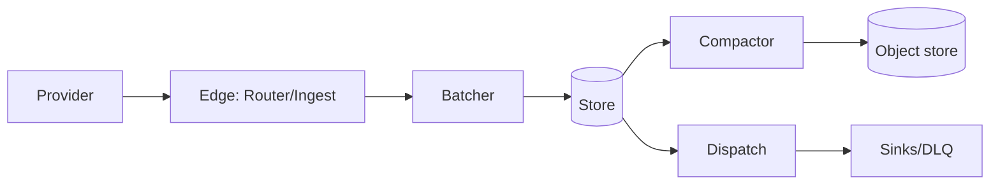

# Agent notes

Ankusa is a self-hosted webhook receiver (Elixir/OTP): write every hook to a
durable local store before answering `2xx`, then dispatch it to
HTTP/RabbitMQ/Kafka/NATS sinks with retries, DLQ, and replay. Full pipeline and
guarantees: [`docs/architecture.md`](docs/architecture.md).

## Repo map

| Path | What |
| --- | --- |
| `packages/ankusa` | Core Mix project: edge/store/storage/dispatch machinery + every zero-external-dep default adapter. No adapter deps (`bandit`, `plug`, `cidr`, `req`, `aws_signature`, `rocksdb`, `telemetry_metrics`/`telemetry_metrics_prometheus_core`, `nebulex`/`nebulex_local`, `opentelemetry_api` (a no-op without the SDK `ankusa_server` ships), `async_api_spex` only). |
| `packages/ankusa_rabbitmq`, `ankusa_kafka`, `ankusa_nats` | One sink adapter each (`Sink.RabbitMQ`/`Kafka`/`NATS`), path-depend on `ankusa` + one broker client (`amqp`/`brod`/`gnat`). `ankusa_kafka` also ships `Ankusa.Intake.Kafka`, the intake log of `wal.type: dual` (ADR 0002). Own `docker-compose.yml` for local broker infra (`ankusa_kafka`'s has a three-broker KRaft cluster beside Redpanda). |
| `packages/ankusa_redis` | Redis adapters: the route store (`Ankusa.Routes.Store.Redis` — definitions in Redis, shared by every edge node) and the pub/sub sink (`Ankusa.Sink.Redis`). Path-depends on `ankusa` + one client (`redix`). Own `docker-compose.yml` (Redis on `:6399`). |
| `packages/async_api_spex` | Generic AsyncAPI 3.0 library, no Ankusa code (structs, `use AsyncApiSpex.Schema`/`Message`/`Channel`/`Spec` — the last three decorate an app's existing structs and publishing modules into a document — validator, `AsyncApiSpex.Plug.RenderSpec`, `mix async_api_spex.gen`). Core depends on it for `Ankusa.AsyncApi`; every project that path-depends on core and builds in `:prod` (the adapters, `ankusa_server`, the examples) pins it by path with `override: true`. Publish it to Hex before core. |
| `conformance/` | Language-neutral SDK vectors (`features.json`, `cases/*.json`; `cases/producer.json` is generated from core's encoder by `mix ankusa.conformance.gen`, never edited) and the checker (`check.mjs`) every `packages/sdk-*` must pass; `mise run check:conformance`. |
| `packages/ankusa_server` | The `jamescarr/ankusa` Docker image: core + every adapter, driven entirely by YAML (`config.ex` is the loader). Not published to Hex. |
| `packages/sdk-typescript`, `sdk-python`, `sdk-rust`, `sdk-ruby`, `sdk-go`, `sdk-php`, `sdk-elixir`, `sdk-java`, `sdk-clojure` | Published client SDKs (npm `ankusa`, PyPI `ankusa`, crates.io `ankusa`, RubyGems `ankusa-sdk`, Go module `github.com/jamescarr/ankusa/packages/sdk-go`, Packagist `jamescarr/ankusa`, Hex `ankusa_sdk`, Maven Central `io.github.jamescarr:ankusa-sdk`, Clojars `io.github.jamescarr/ankusa-clj`) for writing worker consumers. |
| `examples/*` | Runnable Docker-composed demos, one per delivery transport; see [`examples/README.md`](examples/README.md). |
| `deploy/helm/ankusa` | The production Helm chart: StatefulSet (`wal.type: disk \| dual`) or Deployment (`none`), restricted pod spec, probes, PDB, HPA, NetworkPolicy, claim-check gateway. Guide: [`deployment.md`](docs/deployment.md#kubernetes-the-helm-chart). `ci/*-values.yaml` is what `check:examples` renders. |
| `tools/loadgen` | Load generator used by the `oban-consumer` and `fleet-e2e` examples. |
| `deploy/monitoring` | Prometheus alert rules (`prometheus-rules.yaml`, with `promtool` unit tests beside it) and the Grafana dashboard (`grafana/ankusa.json`); `mise run check:monitoring`. |
| `docs/*` | Prose docs, see table below. Index: [`docs/README.md`](docs/README.md). |
| `docs/runbooks/*` | One page per alert family (symptom, metric, action, verification); every alert's `runbook_url` names one. |
| `.mise/tasks/*` | Every CI/dev task, one file each (see Commands below). |

Why the package split (and when a new adapter earns its own package):
[`docs/packaging.md`](docs/packaging.md).

### `packages/ankusa/lib/ankusa` — core module map

| Stage | Modules |
| --- | --- |
| Edge (ingress) | `edge/router.ex`, `edge/ingest.ex`, `edge/batcher.ex` + `batcher_supervisor.ex`, `edge/publish.ex`, `edge/quarantine.ex`, `edge/rate_limiter.ex`, `edge/route_guard.ex`, `dedupe.ex`, `route.ex`, `route_resolver.ex`, `verifier.ex` + `verifier/{hmac,asymmetric,token,client_cert,none,schemes,template}.ex` (`template.ex`: the header/timestamp/signed-bytes half `hmac` and `asymmetric` share) |
| Queue / store (durability) | `queue.ex`, `queue/writer.ex`, `queue/{deliveries,reclaim,archive}.ex`, `intake.ex` + `intake/{pending,gate,reconciler,recovery,memory}.ex` (`wal: :dual`, ADR 0002: the intake log behaviour, the pending set, the breaker, the reconciler, boot recovery; `mix ankusa.recover`, and `docker run … recover` in the server image, both over `Recovery.run_offline/2`; the Kafka adapter is `ankusa_kafka`'s `Intake.Kafka`), `store.ex`, `store/{keys,migrate,migration}.ex` (the store format version and its migration registry), `store/backup.ex` (checkpoint upload to a primary and a secondary object store, signed manifests, verify, final backup on stop, boot restore), `fsync.ex` |
| Storage (compaction + blobs) | `storage.ex`, `storage/compactor.ex`, `blob_store.ex`, `blob_store/{local_fs,s3,gcs,azure,oci}.ex`, `blob_store/azure/managed_identity.ex` |
| Dispatch (sinks, retries, DLQ) | `dispatch/pipeline.ex`, `dispatch/replayer.ex`, `replay.ex`, `sink.ex`, `sink/{log,http,message,description,sqs,google_pubsub}.ex`, `sink/messaging.ex` + `sink/connections.ex` + `sink/reaper.ex` (what a queue-style sink `use`s, and the adapter connection tree with its idle reaper), `sink/batcher.ex` + `sink/{sqs,google_pubsub}/batcher.ex` (the batching worker behind `Sink.SQS` and `Sink.GooglePubSub`, and each sink's request codec), `retry_policy.ex`, `retry_policy/exponential.ex` |
| Claim check (large payloads) | `claim_check.ex`, `claim_check/{pack,ref,router,stores,sweeper,cache,reader}.ex` (`stores.ex`: the claim store list, placement, write failover + breaker, read search; `cache.ex` + `reader.ex`: the gateway's read cache, and its coalescing, per-store adaptive limit, queue and deadline) |
| Route management | `routes.ex`, `routes/{route,matcher,snapshot,cache,router,store}.ex`, `routes/store/ets.ex`, `net.ex`, `net/client_ip.ex` |
| Ops / cross-cutting | `application.ex` (`prep_stop/1` drains the instances in its tree), `config.ex`, `instance.ex` + `instance/{isolated,registry_watch,drain}.ex` (failure domains, registry watch, the SIGTERM drain: `/ready` flips, the ingress listener closes after its requests, the batchers empty), `health.ex` + `health/check.ex` + `health/check/{drain,store,intake,sinks,disk,backlog,backup}.ex` + `health/sink_errors.ex` (`/ready`: the check registry and each check's state, `ok \| failing \| draining`), `source.ex`, `source_store.ex` + `source_store/persistent.ex`, `lifecycle.ex` + `lifecycle/publisher.ex`, `async_api.ex` + `async_api/schemas.ex`, `envelope.ex`, `codec.ex` + `codec/raw.ex`, `admin/router.ex`, `admin/redact.ex`, `reload.ex` (config reload: the reloadable fields of a validated config applied to a running instance, one `config.reload` audit row; the loader registers its reload, `POST /v1/config/reload` runs it), `log_level.ex` (the VM's log level, changed at runtime by `PUT /v1/log-level`; core sets `Logger` metadata — `source_id`, `tenant_id`, `hook_id`, `trace_id`, `sink` — in `edge/router.ex`, `edge/ingest.ex`, `sink.ex`'s `attempt/5` and `dispatch/replayer.ex`), `telemetry.ex`, `metrics.ex`, `http.ex`, `http_client.ex` + `http_client/egress.ex` (every outbound request, and the egress policy `Sink.Http` is checked against), `aws/credentials.ex` (AWS credential chain for S3 and SQS), `ulid.ex`, `uuid_v7.ex` |

`packages/ankusa_server/lib/ankusa_server`: `application.ex` (its `prep_stop/1` runs the same drain for the instance it owns), `cli.ex`,
`fleet_replay.ex` (`docker-entrypoint replay`: one replay job, one job id, `POST /v1/replays` to every node's admin API, followed until each is done; a client, no clustering),
`config.ex` (YAML → core config; `config_version` and its migration map), `config_error.ex`, `gcp_token.ex`,
`reload.ex` + `reload/signal.ex` (config reload on `SIGHUP`, or `POST /v1/config/reload` through core's `reload.ex`: re-read the file, compare it with what the node runs on, refuse a change to a non-reloadable key, apply the rest),
`log_formatter.ex` (`log.format: json`: one JSON object per line, with the redaction of secret keys),
`tracing.ex` (starts the OpenTelemetry SDK and OTLP exporter when `tracing.enabled`).

### Docs index

| Doc | Read it when |
| --- | --- |
| [`quickstart.md`](docs/quickstart.md) | run it with a queue worker, break the worker and the broker, replay |
| [`configuration.md`](docs/configuration.md) | every YAML key, and the Elixir config |
| [`deployment.md`](docs/deployment.md) | roles, the container, fleets |
| [`architecture.md`](docs/architecture.md) | the guarantees, the request path |
| [`delivery.md`](docs/delivery.md) | sinks, retries, DLQ, quarantine |
| [`storage.md`](docs/storage.md) | the node's store and the object stores |
| [`claim-check.md`](docs/claim-check.md) | large payloads to queue workers |
| [`multi-tenancy.md`](docs/multi-tenancy.md) | catch URLs per customer |
| [`integrations.md`](docs/integrations.md) | Oban, Celery, queues |
| [`asyncapi.md`](docs/asyncapi.md) | the AsyncAPI document an instance serves, and lifecycle events (endpoint/route created, updated, deleted) |
| [`elixir.md`](docs/elixir.md) | embed the library in your own app |
| [`testing.md`](docs/testing.md) | running the suites, local infra, what each one covers |
| [`packaging.md`](docs/packaging.md) | why adapters are separate packages, and how to add one |
| [`critical-review.md`](docs/critical-review.md) | the 2026-10 end-to-end review: findings by root cause, and which are fixed |
| [`releasing.md`](docs/releasing.md) | releasing any package: Hex (core, adapters, and the Elixir SDK), the server image, npm, PyPI, crates.io, RubyGems, Go, Packagist, Maven Central, or Clojars |
| [`adr/`](docs/adr/README.md) | the design records ground rule 14 requires before a change to the ack path, the store key layout, a wire format, the isolation model or the durability mode |
| [`runbooks/`](docs/runbooks/README.md) | an alert fired: what to look at and what to do |

Exact callback signatures and options: module docs on [HexDocs](https://hexdocs.pm/ankusa).

## Commands

`mise install` once for the pinned toolchain: repo-wide tools in `.mise.toml`,
each SDK's own toolchain in `.mise/conf.d/<package>.toml`. A new SDK adds its
fragment and leaves `.mise.toml` alone, so parallel SDK PRs don't conflict.
All tasks live in `.mise/tasks/` (one file each); `mise tasks ls` lists every
one; CI runs the same tasks this table does.

| Task | What |
| --- | --- |
| `mise run check` | everything CI checks, every package/example/tool |
| `mise run check:package <pkg>` | one package: format, warnings-as-errors, `credo --strict`, dialyzer, sobelow (core, `ankusa_server`), tests with a coverage floor (core 85 %, others 80 %), docs; starts/stops that package's own `docker-compose.yml` |
| `mise run check:examples` | `examples/*`, and `deploy/helm/*` (`helm lint`, `helm template` for every mode, `kubeconform -strict`) |
| `mise run check:tools` | `tools/*` |
| `mise run check:monitoring` | `promtool check rules` and `test rules` on `deploy/monitoring/`, an existing runbook behind every alert's `runbook_url`, an alert for every row of the SLO table, the dashboard; also part of `mise run check` |
| `mise run lint:pins` | every GitHub action is a commit SHA and every release-image input (Dockerfile `FROM`/`# syntax=`, the BuildKit and SBOM-scanner images) a digest; bump procedure in the task header ([`releasing.md`](docs/releasing.md#supply-chain-pins-sbom-provenance-signature)) |
| `mise run check:conformance` | validate `conformance/`, regenerate the producer vectors from core's `Sink.Message.encode/3` (`mix ankusa.conformance.gen`; fails when `conformance/cases/producer.json` is stale), and run every `packages/sdk-*` against its vectors |
| `mise run test:integration` | `ankusa` core's object-store adapters vs. the floci emulators |
| `mise run test:crash` | crash-consistency drill (needs `docker`): ENOSPC on a 192 MiB tmpfs, then `kill -9` under load; every acked hook must read back. `scripts/drills/flakey.sh` is the power-loss variant on device-mapper (privileged Docker) |
| `mise run e2e` | kind end-to-end gate (needs `docker`; `kind`/`kubectl`/`helm` from `.mise.toml`): the Oban consumer, then the fleet run from the Helm chart (`examples/fleet-e2e/kind.sh`); `mise run e2e oban\|fleet` runs one. The multi-node compose drill is `examples/fleet-e2e/run.sh` (needs `docker`, `mix`, `jq`; `--wal dual --kill-node` is the host-loss drill of the intake log, `--wal disk --kill-node` its control); `.github/workflows/e2e.yml` runs both nightly, on tags, and the fleet one on PRs that touch it |
| `mise run format` | `mix format`, `gofmt`, google-java-format, and cljfmt across every package — run before pushing, not after CI complains |
| `mise run deps` | refresh every `mix.lock` after adding/removing a core dependency |
| `mise run new:adapter <name>` | scaffold `packages/ankusa_<name>/` |
| `mise run status` | every package's version, last tag, published or not |
| `mise run docker:smoke` | build `jamescarr/ankusa:dev`, run `packages/ankusa_server/scripts/smoke.sh` against it (`SMOKE_COSIGN_IMAGE=<published image>` also runs `cosign verify` on it) |
| `mise run bench` | core's in-process ingest → dispatch bench (`N`, `CONCURRENCY`, `BODY_BYTES`, `SINK_LATENCY_MS` pass through) |
| `mise run bench:gate` | the perf regression gate: bench matrix (512 B / 10 KB), median of 3, vs. `packages/ankusa/bench/baseline.json`; p99 > 1.2× or ingest/s < 0.8× fails ([`testing.md`](docs/testing.md#perf-gate-mise-run-benchgate)) |
| `mise run bench:soak` | build the image and soak it under loadgen (`DURATION`, default 3600 s); fails on `missing > 0` or RSS growth > 5 % |
| `mise run build [pkg]` | local only: build one Mix package from source (default `ankusa_server`); compiled Hex deps come from a cache in `~/.cache/ankusa/mix` shared by every worktree, their warnings go to `_build/<env>/deps-compile.log`, ours stay fatal |

## Run the checks before calling work done

Format, warnings-as-errors, and tests — for **every** package the change
touches, not just the one you edited. Every adapter package and
`ankusa_server` path-depend on `ankusa` core, so a core change isn't finished
until they pass too.

| What changed | Run |
| --- | --- |
| a package under `packages/` | `mise run check:package <pkg>` for every touched package (all of them for a core change) |
| `examples/*`, `deploy/helm/*` | `mise run check:examples` (the chart's kind drill is CI's, see [below](#long-drills-run-in-ci-not-here)) |
| `tools/*` | `mise run check:tools` |
| `deploy/monitoring/*`, `docs/runbooks/*`, or a metric an alert reads (`metrics.ex`) | `mise run check:monitoring` (and `mix test test/ankusa/metrics_test.exs` in core: the rules and the dashboard may name only series `Ankusa.Metrics` defines) |
| an SDK (`packages/sdk-*`) or `conformance/` | `mise run check:conformance` (also part of `mise run check`) |
| core's object-store adapters | `mise run test:integration` |
| a hot-path file (`edge/`, `queue/`, `store/`, `dispatch/`, `verifier/`, `routes/`, `store.ex`, `queue.ex`, `dedupe.ex`, `envelope.ex`, `http.ex`, `route_resolver.ex`, `sink/message.ex`, `sink/http.ex` under `packages/ankusa/lib/ankusa/`) | `mise run bench:gate`; put before/after numbers in the PR |
| the ack path (`queue/writer.ex`, `store.ex`, `edge/batcher.ex`) | `ci.yml`'s two crash drills on the PR (ENOSPC/`kill -9`, and the device-mapper power cut); cite them, don't run them ([below](#long-drills-run-in-ci-not-here)) |
| the claim check, route or source stores, or anything a second node shares | `e2e.yml`'s compose fleet run: on the PR when it touches its paths, otherwise the next nightly ([below](#long-drills-run-in-ci-not-here)) |
| the ack path under `wal.type: dual`, the intake log or its recovery | `mise run check:package ankusa_kafka`; the `--kill-node` fleet drills are `e2e.yml`'s ([below](#long-drills-run-in-ci-not-here)) |
| anything, before tagging a release | green `ci.yml` on the commit (its power-loss job is what `release:preflight` reads for `ankusa`); `e2e.yml` runs on the tag itself, and the latest nightly `e2e.yml`/`soak.yml` on `main` is read, not rerun |
| everything | `mise run check` |

### Long drills run in CI, not here

`mise run e2e`, `examples/fleet-e2e/run.sh` (any flags), `mise run bench:soak`,
`mise run test:crash` and `scripts/drills/flakey.sh` take 10 to 70 minutes
each. Don't run them locally, and don't dispatch one and wait on it. CI runs
every one of them:

| Drill | Where CI runs it |
| --- | --- |
| `test:crash`, `scripts/drills/flakey.sh` | `ci.yml`'s two `crash drill` jobs: every PR, every push to `main` |
| `examples/fleet-e2e/run.sh` (`--replay-drill`, `--wal dual\|disk --kill-node`) | `e2e.yml`'s `fleet end to end (compose)`: nightly, every release tag, and PRs that touch `examples/fleet-e2e/**`, `tools/loadgen/**` or the server `Dockerfile` |
| `mise run e2e` (kind: the Oban consumer, the Helm fleet) | `e2e.yml`'s `kind end to end`: nightly, every release tag |
| `bench:soak` (3600 s) | `soak.yml`: nightly |

A drill's evidence is the CI run on the commit, or the latest nightly on
`main`; link it in the PR, and that counts as "ran in this session". When the
run that covers a change is a nightly that hasn't happened yet, say so in the
PR and move on: it is pending, not skipped. Diagnose a red run from its log
(`gh run view <id> --log-failed`); `gh run rerun <id> --failed` only when the
log can't tell a flake from a regression. A red nightly on `main` blocks a tag
until its log is diagnosed: it stops blocking when the cause is fixed in the
commit being tagged (cite the fix's PR and its CI run) or is shown to be the
drill's own fault rather than the shipped code's (say which, in the release
PR).

Changing core's dependencies touches every package that path-depends on it, so
after adding or removing one, run `mise run deps` and commit every `mix.lock`
it changes. CI runs `mix deps.get --check-locked` and
`mix deps.unlock --check-unused` everywhere — including the examples — so a
`deps.get` that rewrites a stale lock, or a lock entry for a dependency nobody
declares, fails the build instead of passing quietly. `mix hex.audit` runs
beside them, so a locked version with a published advisory fails it too.

What each suite covers: [`docs/testing.md`](docs/testing.md).

Working on something that needs a browser or a running system? Exercise the
real thing (or a throwaway script against it) — see the verification
requirements in the project brief.

Two rules that follow from all of the above:

- **Never report a check as passing unless it ran in this session.** "It
  should work", "the code looks right", and a hand-written log line are not
  evidence. For the long drills, the CI run you link is the run.
- **Never mark a task done while its own acceptance criteria fail** — a
  step that crashed, or a check that was never run, is not done; a red CI drill
  counts as a failure. Say what failed and what's still open (a nightly that
  hasn't run yet is open, and reported as pending).

## Dependencies

**Take the dependency when it is the right tool.** Judge it on merit: is the
library more correct, better tested, and less surface for us to own and be wrong
about than the code it replaces? Then use it. "Zero dependencies" is not a goal,
and refusing a good library to keep a count at zero is not a principle — it is
how you end up maintaining hand-rolled SigV4 signing.

The rule that *does* hold is about placement: a dependency only some deployments
need goes in its own adapter package, so nobody else's `mix deps.get` compiles
it. A dependency every user benefits from belongs in `ankusa` core. Full decision
rule, and the worked examples: [`docs/packaging.md`](docs/packaging.md).
