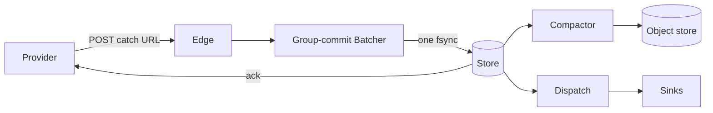
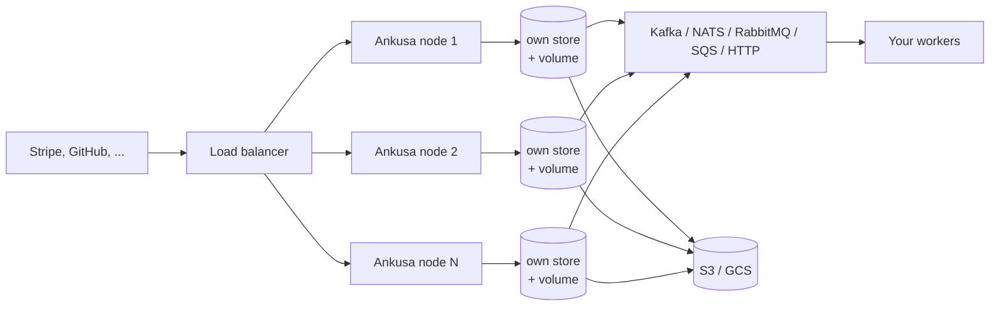

# Ankusa

<p align="center">
  
</p>

[](https://hub.docker.com/r/jamescarr/ankusa)
[](https://github.com/jamescarr/ankusa/actions/workflows/ci.yml)
[](https://hex.pm/packages/ankusa)
[](https://github.com/jamescarr/ankusa/blob/main/LICENSE)

_**Don't fight the traffic. Steer it.**_

Ankusa is a self-hosted webhook receiver. Point Stripe, GitHub, or any provider
at it and it verifies the signature, writes the hook down, and only then answers
`2xx`; delivery to your workers happens afterwards, with retries, a dead-letter
queue, and replay. It is for teams that need a durable inbox in front of their
consumers without operating a stream processor just to accept a POST. One
container is a complete receiver; more containers are a fleet, not a rewrite.

That is the whole promise: **a `2xx` means the hook is stored somewhere that
survives the failure you are worried about.** Which "somewhere" is one config
key, `wal.type`. Nothing else in this README matters as much:

| `wal.type` | `201 accepted` means | An acked hook survives | Needs |
| --- | --- | --- | --- |
| `disk` (default) | fsynced in this node's local store | process crash and power loss on this host. A lost host loses the hooks acked since the last backup — all of them if backup is off. | local disk |
| `dual` | fsynced here **and** confirmed in the Kafka intake log | loss of this host, unless every in-sync replica of the log is lost with it | Kafka with `replication.factor ≥ 3`, `min.insync.replicas ≥ 2`; backup on |
| `none` | every sink confirmed, in the request | whatever the sink durably holds; the provider is the retry | a sink whose confirm means durable |

Under every mode, a node that cannot keep that promise answers `503` with
`Retry-After` instead of a `2xx`. Hooks are delivered at least once; consumers
dedupe on the idempotency key. [`docs/architecture.md`](docs/architecture.md)
walks the request path and the failure modes.

## Run it

```sh
export ANKUSA_ADMIN_TOKEN=$(openssl rand -hex 32)   # the admin API needs a credential off loopback
docker run -d --name ankusa \
  -p 4000:4000 -p 127.0.0.1:4002:4002 -e ANKUSA_ADMIN_IP=0.0.0.0 -e ANKUSA_ADMIN_TOKEN \
  -v ankusa-data:/var/lib/ankusa \
  jamescarr/ankusa:edge

# the image ships a healthcheck: wait for it rather than racing the listener
until [ "$(docker inspect --format '{{.State.Health.Status}}' ankusa)" = healthy ]; do sleep 1; done

curl -XPOST localhost:4000/webhooks/demo -H 'content-type: application/json' -d '{"id":"evt_1"}'
# => {"id":"01a0...","status":"accepted"}   (returned only after the store fsync)
```

4000 is ingest, 4002 is the operator API (`/health`, `/metrics`), and
`/var/lib/ankusa` holds the only state worth keeping. The image's default
config declares a `demo` source that accepts anything and logs it, so this
works before you have any provider credentials. Done? `docker rm -f ankusa`.

## Deliver to your worker

Ankusa POSTs each hook to your endpoint with the raw body intact, and delivery
is signed by default: the receiver verifies the Standard Webhooks signature
against the sink's `secret`. Short outages are retried; long ones land in a
dead-letter queue you can replay with one call.

```sh
git clone https://github.com/jamescarr/ankusa
cd ankusa/examples/quickstart
docker compose up --build -d --wait
curl -XPOST localhost:4000/webhooks/demo -H 'content-type: application/json' -d '{"id":"evt_1","type":"invoice.paid"}'
sleep 1 && docker compose logs worker
# received id=01a0... source=demo bytes=36 body={"id":"evt_1","type":"invoice.paid"}
```

The wiring is one sink in [`ankusa.yml`](https://github.com/jamescarr/ankusa/blob/main/examples/quickstart/ankusa.yml). The
demo worker is plain `http://` at a private address, which sinks may not reach
until `egress` says so; a production sink is an `https://` URL on a public name
and needs no `egress` block:

```yaml
egress:
  allow_insecure_http: true
  allow_hosts: [worker]

sources:
  demo:
    verify: {type: none}
    on_verify_failure: accept_flag
    sinks:
      - type: http
        url: http://worker:8080/hooks
        timeout_ms: 5000
        allow_unsigned: true   # demo only: this worker does not verify
```

A real sink sets `secret: ${WORKER_WHSEC}` and its receiver verifies the
signature ([`docs/integrations.md`](docs/integrations.md#signed-deliveries)).
The worker is [a small FastAPI app](https://github.com/jamescarr/ankusa/blob/main/examples/quickstart/worker.py) built with
[`uv`](https://docs.astral.sh/uv/) using the `ankusa` Python SDK
([`packages/sdk-python`](https://github.com/jamescarr/ankusa/tree/main/packages/sdk-python)); replace it with your own
service. [`docs/quickstart.md`](docs/quickstart.md) breaks the worker, replays
the dead letters, and points a real provider at it.

## How it works

A POST is accepted only after a durable write, and the accepted write is the
only thing `201` ever means. Each accepted POST is a new hook with a fresh
`id`, unless the source sets [`dedupe`](docs/configuration.md#sources) on a
provider event key; then a repeat within the TTL is `201 duplicate` with the
original `id` and nothing new is stored. Verification runs before the write,
and its failure policy is per source: reject, quarantine in a durable,
rate-limited pen, or accept flagged.

After the accept, ingest and delivery are fully decoupled. A commit writes the
hook and one delivery row per sink in one store batch. Dispatch is a scheduler
over the due rows; the compactor packs archived hooks into immutable segments
in an object store. Neither is an RPC caller of the other, so a slow sink, a
dead compactor, or a paused dispatch node never stops the edge from acking.
`wal.type: none` skips the store and the retry machinery entirely: one request,
one concurrent publish, and the provider's retry is the only retry.



## Operating it

The control plane is the admin API on `admin.port` (4002 in the image), and it
is authenticated: bearer tokens with scopes, OIDC/JWT, or mTLS. It serves
`/health`, `/metrics`, the redacted effective config, source management, the
dead-letter queue, replay jobs, quarantine release/purge, and a durable audit
trail of every change and replay. When `source_store` keeps sources in the
store or Redis, their secrets are encrypted at rest with `secrets.kek`;
`check-config` and `print-config` validate and show the effective config
without starting the node.

Backups are off by default and worth turning on. With `backup.enabled`, a
checkpoint of the store and its `intake_offset` goes to an object store every
`backup.interval_ms`, with a manifest that `backup.signing_key` signs; a node
starting on an empty `data_dir` restores the latest checkpoint before opening
the store, checks it, and refuses to start on a corrupt or unreadable backup
rather than starting empty. A clean stop writes a final checkpoint.

Tenants are a first-class scope: the tenant id is in the store key, rate
limits and dispatch fairness are per tenant, routes and source definitions can
be shared through Redis, and a tenant can be erased. [`docs/multi-tenancy.md`](docs/multi-tenancy.md)
has the URL schemes and the isolation rules.

Observability is `/metrics` (Prometheus) plus `:telemetry` events under
`[:ankusa, ...]` for every stage. Gauges cover the store, queue depth, oldest
due age, quarantine bytes, disk free, and open dispatch breakers — enough to
alert on a backlog before a provider sees a `503`. There is no OpenTelemetry
tracing or structured-JSON logging yet.

## Run a fleet

When one box is not enough, run N independent all-role nodes behind a load
balancer. Each node has its own data volume, its own store, and its own
admin/replay API; they share nothing but the provider's traffic, and optionally
Redis for routes, sources, and fleet-scoped rate limits and dedupe. `edge`,
`dispatch`, and `storage` must stay in one BEAM node because they share the one
local store — a node is the unit of scale. The one role you may split out is
`:claim_check`, the large-payload gateway, which never opens the store.

Give each node its own archive prefix (`storage.key_prefix`) or its own bucket:
segment keys are `seg/<first_seq>-<last_seq>.seg` and remote blob stores ignore
the instance, so nodes sharing a bucket without a prefix overwrite each other's
segments. Claim keys are never prefixed, so one claim-check gateway can serve
the whole fleet.

Under `wal.type: dual`, the intake log also survives a lost host: restore that
node's backup under its stable `intake.node_id` and run `recover` to replay
whatever the backup does not hold.



Your workers can be written in anything. A TypeScript, Python, Ruby, or Go
consumer reads from the queue and fetches large payloads over the claim-check
gateway without ever holding storage credentials. Roles, the container, and
fleet operations: [`docs/deployment.md`](docs/deployment.md).

## Examples

Each example is runnable, ends with a worker you could replace, and picks a
different transport.

| Example | Delivers via | Worker | Shows |
| --- | --- | --- | --- |
| [quickstart](https://github.com/jamescarr/ankusa/tree/main/examples/quickstart/) | HTTP | Python | retries, dead letters, replay |
| [rabbitmq-consumer](https://github.com/jamescarr/ankusa/tree/main/examples/rabbitmq-consumer/) | RabbitMQ | TypeScript | consumer-owned queues, large payloads via the claim-check gateway |
| [kafka-sqs-consumer](https://github.com/jamescarr/ankusa/tree/main/examples/kafka-sqs-consumer/) | Kafka → SQS FIFO | TypeScript | SQS FIFO handoff, failure drills |
| [nats-consumer](https://github.com/jamescarr/ankusa/tree/main/examples/nats-consumer/) | NATS JetStream | Rust | a consumer-owned stream, claim-check redemption with the published Rust crate |
| [oban-consumer](https://github.com/jamescarr/ankusa/tree/main/examples/oban-consumer/) | HTTP → Oban on Kubernetes | Elixir | a fleet of independent nodes, each with its own on-disk store, load-tested with pods killed mid-run |
| [fleet-e2e](https://github.com/jamescarr/ankusa/tree/main/examples/fleet-e2e/) | RabbitMQ, two nodes behind nginx | TypeScript | shared routes, sources, bucket prefixes, and a node killed mid-run; run nightly in CI |
| [jetstream-k8s](https://github.com/jamescarr/ankusa/tree/main/examples/jetstream-k8s/) | NATS JetStream on kind | TypeScript | an autoscaling direct-mode fleet and a durable fleet, with a browser control panel |

How to pick one, and what each proves:
[`examples/README.md`](https://github.com/jamescarr/ankusa/blob/main/examples/README.md).

## Documentation

- [Quickstart](docs/quickstart.md)
- [Architecture and guarantees](docs/architecture.md)
- [Configuration](docs/configuration.md)
- [Deployment and scaling](docs/deployment.md)
- [Delivery, retries, and dead letters](docs/delivery.md)
- [Storage and backup](docs/storage.md)
- [Multi-tenancy](docs/multi-tenancy.md)
- [Claim check](docs/claim-check.md)
- [Integrations: Oban, Celery, queues](docs/integrations.md)

Everything else, including the contributing docs:
[`docs/README.md`](docs/README.md). Ankusa is also an Elixir library you can
embed in your own app: [`docs/elixir.md`](docs/elixir.md) ·
[HexDocs](https://hexdocs.pm/ankusa).

## The name

अंकुश (aṅkuśa) is Sanskrit for "hook" or "goad": the curved tool a mahout uses
to steer an elephant. Its root, aṅka, means "to bend" or "curve".

Webhook traffic behaves like the elephant. It is large, it arrives on its own
schedule, and it will not wait for you. So the framework takes the same shape:
absorb the traffic durably and fast through the store and batcher, then steer
where it goes next through routing and dispatch.

## License

Apache 2.0. See [LICENSE](https://github.com/jamescarr/ankusa/blob/main/LICENSE).
