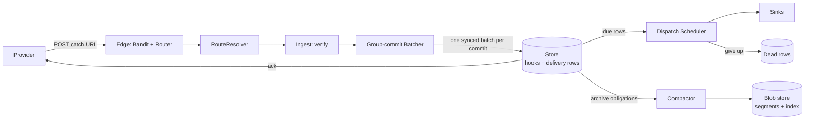
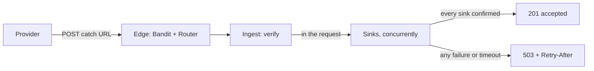
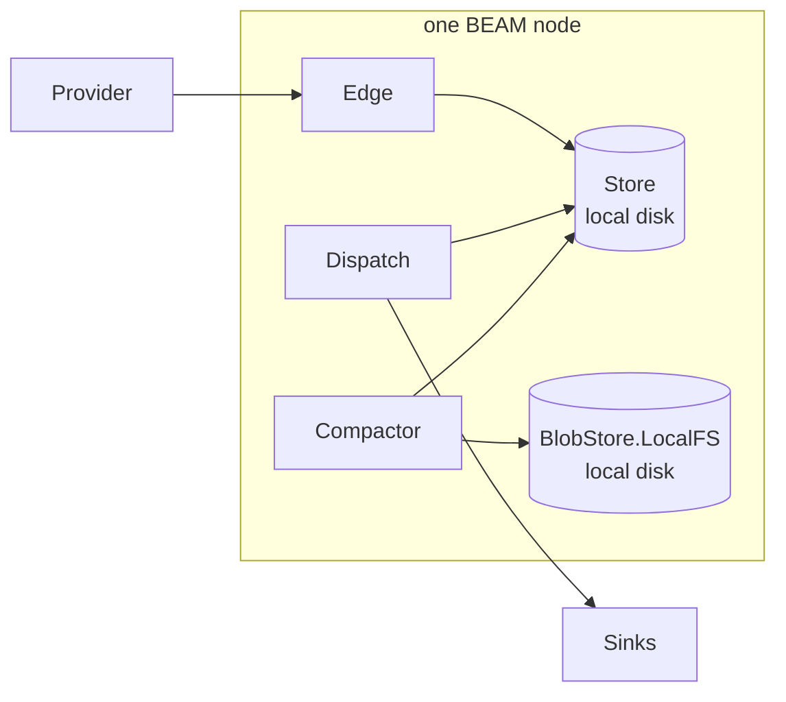
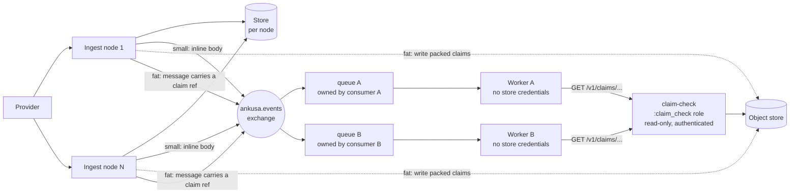
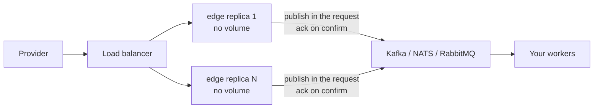

# Architecture

## The core invariant

**Never return `2xx` until the hook is durably accepted.** Which system accepts
it is one config key, `wal.type`: `disk` (the default) commits to this node's
store — the queue's mode; the name `wal` is historical — and dispatches
asynchronously; `dual` does that **and** confirms the hook in a replicated
intake log (Kafka) before the ack, so a lost host loses nothing; `none`
publishes to the source's sinks inside the request and acks on their confirm.
No mode ever promises what nothing stored. Every other design decision in this
framework is downstream of that one sentence.

- **Crash before the accept:** no `2xx` was sent. The provider retries. Nothing
  was lost because nothing was promised.
- **Crash after the accept, before the HTTP response leaves:** the provider
  retries anyway (it never saw the `2xx`). Without a source
  [`dedupe:`](configuration.md#sources) setting, that retry is a new hook: a fresh `id`, stored and delivered again. Delivery
  is at-least-once; consumers are idempotent receivers.
- **Store slow or down:** `503` with `Retry-After`. Under `wal.type: disk` that
  is the store refusing a commit; under `dual` it is the store or the intake
  log (`intake_unavailable`, `intake_pending`); under `wal.type: none` it is a
  sink refusing the publish — same answer, because in that mode the sink *is*
  the store. Never ack what wasn't saved, ever, under any load condition.

The one loss window this can't close is a provider that doesn't retry on a
timeout or `5xx`. That's their contract, not a bug here. Document it to
whoever's provider you're catching.

The default single-node setup (`wal.type: disk` + `BlobStore.LocalFS`) survives
process crash and power loss **on that box**, not loss of the box. The
startup log says so, in one line, on purpose: durability claims should never
be quietly stronger than what's actually true. The queue commits to one
RocksDB database per instance at `<data_dir>/<instance>/store`, owned by the
`Ankusa.Store` process; it is local to one BEAM node, so run every store
role together and scale out with independent nodes. See
[Deployment topologies](#deployment-topologies).

Losing the box is covered by [`backup`](configuration.md#backup), off by
default: every `backup.interval_ms` (60 s) a checkpoint of the store goes to
an object store (and to a second one, `backup.secondary`, if configured),
described by a manifest that `backup.signing_key` signs and that
`backup.verify_interval_ms` reads back; a clean stop takes one last checkpoint.
A node that starts on an empty `data_dir` restores the latest one before it
opens the store — or refuses to start when the backup location can't be read
or a check fails, never "starts empty". Hooks acked after the last backup are
lost with the box (none, after a clean stop; their archive copies, if the
compactor wrote any, are catalogued again); the startup log names the
interval. See [`storage.md`](storage.md#backup-and-restore); proofs:
`store/backup_test.exs` (`verify detects corruption`, `manifest signature`,
`final checkpoint on stop`, `secondary restore`).

`wal.type: dual` closes that last window. Every hook is fsynced on this host
**and** confirmed in the **intake log** — a replicated Kafka topic
(`acks=all`, `min.insync.replicas=2`, `ankusa_kafka`'s `Ankusa.Intake.Kafka`) —
before the `201`; the two halves run in parallel, so the ack costs the larger
of the fsync and the confirm, not their sum. A replacement node started on an
empty volume with the lost node's `intake.node_id` restores the latest backup
and replays the log from the backup's offset: every acked hook comes back.
The log never gives up an ack silently: a node that cannot confirm in it
answers `503 intake_unavailable` and acks nothing, never "disk only". A hook
that half-persists (one half failed, the other did not) is carried to
completion by a reconciler, not undone. See
[`adr/0002-dual-commit-intake-log.md`](https://github.com/jamescarr/ankusa/blob/main/docs/adr/0002-dual-commit-intake-log.md),
[`deployment.md`](deployment.md#host-loss-and-the-intake-log) and
[`storage.md`](storage.md#the-intake-log); proofs: the fleet drill
`examples/fleet-e2e/run.sh --wal dual --kill-node` (host loss, the log's brokers
down, a secondary-backup-only restore), `queue_dual_test.exs` (`no ack without
intake confirm`) and `loss_test.exs`.

| `wal.type` | `2xx` means | An acked hook is lost when |
| --- | --- | --- |
| `disk` | fsynced on this host | this host is lost, after the last backup (`backup.interval_ms`, 60 s) |
| `dual` | fsynced on this host **and** confirmed in the intake log | this host **and** every in-sync replica of the log's partition are lost together (Kafka: replication factor 3, `min.insync.replicas` 2: two brokers, before they fsync, plus the host) |
| `none` | every sink confirmed | no sink keeps it (each sink's own durability) |

The startup log says which row applies, in one line.

`wal.type: none` makes the node stateless instead: no queue, no batcher, no
dispatch pipeline, no compactor, no DLQ, and the only role left is `:edge`. The
store still runs for the quarantine pen and the API-managed sources and
rate-limit overrides, but no hook is ever written to it. The broker's confirm
replaces the `fsync`, and "the provider is the retry" replaces the retry
policy — see [Deployment topologies](#4-stateless-ingest-fleet-wal-none)
and [`delivery.md`](delivery.md#direct-mode).

## The pipeline

Ingest and dispatch are **fully decoupled**. A commit writes the hook and one
delivery row per sink in one store batch; dispatch is a scheduler over the
due rows, and the compactor works over the archive obligations that same
commit wrote. Neither is an RPC caller of the other, and neither is an RPC
target of the edge. Take the compactor down: ingest keeps acking, the
obligations pile up, nothing is lost — watch `ankusa_queue_archive_pending`
and the store's size. Take dispatch down: same story, deliveries just wait as
due rows, `ankusa_queue_oldest_due_age_seconds` climbs, and a row it had
already claimed is put back as due at the next start. This is
the "durable state, not RPC" rule and it
holds at every boundary in the system, including across separate adapter
packages (see [`packaging.md`](packaging.md)) and across independent nodes,
which share nothing but the provider's traffic.

`wal.type: none` skips the queue entirely — one request, one publish, still one
honest ack:

No batcher, no queue, no compactor, no dispatch pipeline, no DLQ. The request
process publishes to each of the source's sinks and answers only once all have
confirmed (`Kafka` `acks=all`, a publisher confirm, a JetStream ack, an HTTP
`2xx`); any failure or timeout is the `503`, and the provider — not a retry policy —
is the retry. `c:Ankusa.Sink.durable?/1` is the contract behind that promise, and
boot refuses a `wal: :none` config in which no sink of a static source can make
it. Detail in [`delivery.md`](delivery.md#direct-mode).

## Request path, step by step

1. **`Ankusa.Edge.Router`** (`Plug.Router` under Bandit) matches any path via a
   catch-all `POST` and hands it to `Ankusa.RouteResolver.resolve/2`, the
   pluggable seam that turns a URL into `%Ankusa.Route{source_id, tenant_id}`
   (see [`multi-tenancy.md`](multi-tenancy.md)). It then does everything that
   can refuse the request *before reading its body*: a `Content-Length` above
   `max_body_bytes` is `413`, and a source that does not exist is `404` — so
   is a source owned by one tenant asked for under another tenant's URL (a
   source with the default tenant `"default"` is shared and answers any
   tenant), and a source store that cannot answer is `503`, never `404`. Only
   then does it read the body, still bounded by `max_body_bytes` as it streams
   (a chunked body has no length to check up front). Refusals are counted on
   `ankusa_ingest_refused_total{instance,reason}` and never create a
   per-source series, so an unauthenticated caller cannot grow `/metrics`.
2. **`Ankusa.Edge.Ingest`** builds a `%Ankusa.Envelope{}` for the source the
   router looked up via `Ankusa.SourceStore` (raw body kept byte-for-byte
   verbatim: signature checks need the exact bytes, not a re-serialized copy;
   it is copied only when it is a slice of a larger binary), and runs the
   source's `Ankusa.Verifier`.
   - The request's headers are stored under the `store_headers` policy,
     applied after verification (the verifier and the dedupe key read every
     header): `authorization`, `cookie`, `x-api-key` and the other credential
     headers are dropped by default, and a hashed one is kept as
     `sha256:<hex>`. What the policy removes is in no stored hook, archive
     segment, quarantine entry or sink message. See
     [`configuration.md#stored-headers`](configuration.md#stored-headers).
   - Verification failure follows the source's `on_verify_failure` policy:
     `:reject` (`401`, nothing stored), `:quarantine` (`202`, held in a
     durable pen with a per-source rate limit and a byte cap — `429` or `503`
     when either refuses — until a `quarantine` replay job re-verifies and
     releases it. See [`delivery.md`](delivery.md#quarantine)), or
     `:accept_flag` (commits anyway, envelope marked `flagged: true`).
     A source that verifies with SHA-1 (an inline `hmac` scheme only) is
     counted on `ankusa_verifier_weak_hash_total{instance,source_id,scheme}`
     whether or not the signature matched, and the replay window
     (`tolerance_seconds`) is capped at an hour; both are tested in
     `verifier_test.exs` and `metrics_test.exs`.
   - Five verifiers ship in core: none, an HMAC signature, an Ed25519 or RSA
     public-key signature (`Verifier.Asymmetric`, which holds no secret), a
     static bearer/basic/header/query credential (`Verifier.Token`) and the
     pinned mutual-TLS client certificate (`Verifier.ClientCert`). The edge
     hands a verifier only the request context it reads, through its `opts`:
     the peer certificate (a live TLS-socket call, made for `ClientCert`
     sources alone) and the query string (`Token`), so the envelope and the
     stored format are unchanged. A token's header is dropped from what is
     stored, whatever the `store_headers` policy. Tested in `verifier_test.exs`
     (the Standard Webhooks `v1a` reference vector, wrong key, stale
     timestamp, tampered body, each token location, each certificate pin),
     `edge_test.exs` (through the router) and `instance_test.exs` (a real
     mutual-TLS handshake).
   - An accepted hook is charged against its tenant's ingest quota
     (`rate_limits`: hooks and bytes per second) before anything is written.
     Over the limit is `429` with `Retry-After`, nothing stored — and because
     the charge comes after verification, a flood of forged requests spends no
     budget and can never lock a tenant out. A forged hook is not free either:
     one accepted *flagged* (`accept_flag`) or quarantined spends its source's
     quarantine bucket (`429 quarantine_rate_limited` past it), and a flagged
     hook gets no dedupe key, so it cannot suppress the real event. What a
     forged request *does* spend is the pre-read admission, which runs after
     the source lookup and before the body is read: a limit per client address
     (`429 ip_rate_limited`), per node (`429 node_rate_limited`) and per source
     in body bytes per second (`429 source_rate_limited`), plus the tenant's
     `max_body_bytes` (`413`) — CPU protection that a flood meets before it
     costs a read or an HMAC. A tenant can also be given a share of the batchers
     (`max_queue`, `max_queue_bytes`): past it the tenant gets
     `429 tenant_overload`, and the other tenants never see a `503 overload`
     it caused. See [`configuration.md#rate-limits`](configuration.md#rate-limits);
     tested in `edge_rate_limit_test.exs` (`per ip pre-read`, `tenant overload
     isolates`, `tenant body cap`).
3. **`Ankusa.Edge.Batcher`** (one GenServer per partition, default two)
   receives the envelope and **blocks the caller** until the batch it lands
   in commits. The flush to the store runs in a `Task`, so the batcher keeps
   accepting while a commit is in flight. The next batch accumulates behind
   it and commits the instant the previous one returns. `max_batch`
   (default 256) bounds one batch, `max_delay_ms` (default 0) adds no linger.
   Every blocked caller is replied to only after that commit returns; that's
   what makes the ack honest. The queue is bounded twice — `max_queue`
   (default 10,000) records and `max_queue_bytes` (default 256 MiB) of body,
   both counting buffered *and* in-flight records: full means `503` with
   `Retry-After`, never a promise the store can't back. Those bounds are the
   partition's, shared by every tenant; a tenant's `max_queue` and
   `max_queue_bytes` count its own records across partitions, so it hits
   `429 tenant_overload` before it can fill them.
4. **`Ankusa.Queue`** commits the batch to the store durably and returns
   `{:committed, envelope}` (with `seq` assigned) or `{:duplicate, envelope}`
   (the original's `id`; nothing stored) per record, in the original
   order. The edge maps this to
   `201`/`202`/`401`/`404`/`413`/`429`/`503`; a body it cannot read at all
   (client disconnect, read timeout) is `400`, kept distinct from `413` rather
   than reported as "too large". A header name or value holding a byte outside
   visible ASCII (space and tab allowed in values) is also `400 invalid_header`,
   refused before the body is read: no sink can carry it.

Under `wal: :none` steps 3 and 4 do not exist: **`Ankusa.Edge.Publish`** asks
all of the source's `Ankusa.Sink`s at once, concurrently, in the request
process, under one deadline (`direct_publish_timeout_ms`, default 8 s). The
status mapping below is unchanged, but the `201` now waits on
every sink's confirm instead of the store commit. A sink refusing, raising,
throwing, exiting or missing the deadline is the `503`, and nothing is retried here.

From here, ingest is done. Two independent consumers work off the same store:

- **`Ankusa.Storage.Compactor`** takes the archive obligations in `seq` order,
  by stored size up to `storage.roll_bytes`, encodes the hooks into one
  immutable segment via `Ankusa.Codec`, `PUT`s the segment and its index
  object to `Ankusa.BlobStore`, writes the catalogue row, and clears the
  obligations. Hooks dispatch hasn't consumed yet are not touched, so
  at-least-once delivery survives compaction. Detail in
  [`storage.md`](storage.md).
- **`Ankusa.Dispatch.Pipeline`** is a scheduler over delivery rows: it claims
  due rows tenant by tenant (deficit round-robin over the tenants with work
  due, up to `dispatch.concurrency` deliveries at a time, bounded by
  `dispatch.max_inflight` claims and `dispatch.max_inflight_bytes` of stored
  hook bodies, and for each tenant by its own window,
  `dispatch.tenants`), queues them per sink key
  `{tenant, source, sink index, module}`, hands slots round-robin across the
  tenants and then across a tenant's keys, delivers each to the sink its row
  was bound to, retries per the source's `Ankusa.RetryPolicy`, parks a key
  whose circuit breaker is open, and dead-letters on give-up. Delivery is not
  ordered; a consumer that needs order has to rebuild it from data it receives
  and tolerate redelivery. Detail in [`delivery.md`](delivery.md).

## Guarantees, by component

| Component | Guarantee |
| --- | --- |
| `Ankusa.Store` (the `wal.type: disk` queue) | One RocksDB database per instance. A commit is one synced batch: the hook, one pending delivery row per sink, an archive obligation while `:storage` runs, the seq marker, and, for a hook with a dedupe key, the dedupe key and its expiry key. A torn tail (an unacked write) is dropped on open; damage before it refuses to start (`{:store_open_failed, …}`) rather than silently shortening a read. LocalFS blob writes are fsynced (temp file, rename, directory). |
| Group-commit batcher | One process per partition (`batcher.partitions`, 4 by default) that holds its callers' bodies, encodes their delivery rows and reads their dedupe keys in a supervised commit task (up to `batcher.max_commits`, 64, in flight per partition, so the writer finds every waiting caller in its mailbox), then hands the prepared batch to the queue writer. The writer merges every batch queued from every partition into one **group** (`batcher.group_commit_max_bytes`, 4 MiB, and `batcher.group_commit_max_records`): one synced store write and, under `wal.type: dual`, one intake publish, with seqs dense across the group, while the next group accumulates behind it. Because a caller's dedupe read can predate another partition's commit, the writer re-validates it before it assigns seqs: the first occurrence of a key wins, and later ones answer `duplicate` with its hook id (and, under `dual`, a retry that meets an unconfirmed original is `503 intake_pending`). Callers block until their own group returns; bounded queue (buffered + in-flight) sheds load as `503` rather than queuing unboundedly. Every record carries a deadline (15 s by default) for its batch to *start* committing: a record still buffered at its deadline behind a stalled commit is answered `503` and dropped, and the writer refuses a batch that missed its deadline. A batch the writer has started is never abandoned, so a stall never answers `503` for a hook it then commits; a process dying while the writer is mid-commit (the commit task, the batcher, or the writer after its sync) still can, and the provider's retry stores that hook again. |
| Ingest | Every accepted POST is durably accepted and answered `201 accepted`, and `201` is the only committed response. There is no `200`. Under the default `wal.type: disk` that accept is the store commit; under `dual` it is the store commit plus a confirmed intake-log publish; under `wal.type: none` it is every sink's confirm. A source with [`dedupe:`](configuration.md#sources) collapses hooks sharing a provider event key within the TTL (default 72 h): the repeat gets `201` with the original `id` and `"duplicate": true`, and nothing new is stored. Without it, a provider retry after a lost ack is a new hook with a new `id`, stored and delivered again. The dedupe index is bounded: `dedupe.max_entries` live keys on the node and `dedupe.max_entries_per_tenant` for one tenant; a hook whose key would pass either is refused `503 dedupe_quota` (`Retry-After: 60`), never stored without its key, and keys are expired by `Ankusa.Queue.DedupeSweeper`, never inside the writer ([`storage.md`](storage.md#ingest-dedupe-keys-bounded-expired-outside-the-writer); tests `test/ankusa/dedupe_test.exs`: `dedupe bucket sweep`, `dedupe.max_entries refuses a new key`, `a key refreshed after the sweeper read it survives its stale delete`). Consumer contract in [`delivery.md`](delivery.md#idempotent-receivers). |
| Fleet scope (`rate_limits.scope: :fleet`, `dedupe.scope: :fleet`) | The tenant quota and the provider event key are counted in `fleet.store` (Redis), one call per hook, so N nodes enforce one limit and one dedupe window. The event key is claimed *pending* before the commit and made *committed* only after it (`Ankusa.Dedupe.Store`): another node meeting a committed key answers `201` with the first hook's `id`, meeting a pending one `409 dedupe_pending` (a `2xx` for a hook whose commit then fails would lose it), and a failed commit releases the claim. Each call has a hard budget (`fleet.timeout_ms`) and a breaker takes a slow or dead store out of the path: the node then limits and dedupes alone and `ankusa_fleet_limiter_degraded` reads `1`, never a `503`. Proof: `edge_fleet_test.exs` and, against Redis, `ankusa_redis`'s `rate_limiter/store/redis_test.exs`. See [`configuration.md#fleet-scope`](configuration.md#fleet-scope). |
| `wal: :none` (direct ack) | Ingest publishes to every sink concurrently in the request, under one deadline (`direct_publish_timeout_ms`, default 8 s), and answers `201` only after each confirmed; any sink failure, crash or timeout is a `503` with `Retry-After`, with no internal retry, and sinks that confirmed keep their copy. No queue, no batcher, no dispatch pipeline, no compactor, no DLQ: the provider is the retry and the sink's destination is the durable store. `c:Ankusa.Sink.durable?/1` is the per-sink promise, checked at boot for every static source. The local state this mode keeps is the quarantine pen (rows appear only for a source that asks for it), API-managed sources and rate-limit overrides, all in the store. |
| `wal: :dual` (intake log) | A hook is acked when its synced local write **and** the intake log's confirm (`required_acks: -1`, every in-sync replica, at least `min.insync.replicas`) are both done; the batch's two halves run concurrently, so the ack is the larger of the two. The writer's reply is a message, not a wait: the next batch commits while the previous one waits for its confirm. A half-persisted hook (one half failed) is `503` to the provider and **carried**: the pending set holds it and the reconciler completes the missing half, with the fleet dedupe claim held pending and promoted only when both halves are confirmed, so the provider's retry is `503 intake_pending`, then `201 duplicate` with the first id, never a second hook. An open breaker (`intake.breaker_failures` failed publishes) answers `503 intake_unavailable` **before** either half is touched. Boot recovery replays the log from `m:intake_offset` through one seq-and-hook-id rule (a duplicate or reordered record changes nothing), republishes the local hooks above the watermark, and the node serves nothing until it is done. Kafka has no idempotent producer here (`brod`), so every reader dedupes. Proven by `queue_dual_test.exs`, `intake/{reconciler,recovery}_test.exs`, `ankusa_kafka`'s `intake/kafka_test.exs` and the fleet drill. |
| Compactor | Never writes one object per hook: it takes archive obligations byte-sized up to `storage.roll_bytes` and packs them into one immutable segment plus one index object. A failed blob write ends the tick and the same hooks are retried next tick. |
| Dispatch | At-least-once to every sink, concurrent up to `dispatch.concurrency` and bounded by `dispatch.max_inflight`/`max_inflight_bytes`, exponential backoff with jitter, dead-letter on give-up, a raising sink retried rather than fatal. Not ordered: ordering lanes are gone, and a consumer that needs order has to rebuild it from data it receives. A scan claims from the tenants with work due by deficit round-robin (each gets an equal share of a page, a tenant with less leaves the rest to the others, a tenant the page did not reach goes first next time), and each tenant is held to its own window (`dispatch.tenants`: `max_inflight`, `max_inflight_bytes`, `concurrency`), so a tenant whose sink is slow fills its own window and nobody else's: `tenant fairness` in `test/ankusa/dispatch/isolation_test.exs` runs 99:1 load behind a slow sink and holds the light tenant's p99 delivery lag within 2x of its solo p99 (`bench/tenant_fairness_bench.exs` prints both tenants' p99). Breakers and `dispatch.sink_concurrency` are per tenant (the sink key carries it). The scan costs the tenants with work due, not the backlog or the tenant count (`bench/dispatch_tick_bench.exs`). DLQ entries are dead delivery rows; a replay moves them back to pending, so a replayed hook leaves the DLQ. |
| Quarantine | A durable pen in the store, bounded three times: a token bucket per source (`quarantine.burst`/`rate`, default 100 / 20 per s; over it, `429 quarantine_rate_limited`), a cap on its total bytes (`quarantine.max_bytes`, default 1 GiB; a full pen answers `503 quarantine_full` and never evicts a held hook) and at most 1 000 writes waiting for its disk write (`503 overload`, `ankusa_quarantine_pending`). The bucket, the byte count and the waiting count are ETS operations in the request's own process, so a forged flood never queues another source's hook (or an `accept_flag` hook's charge) behind it; the writes are one group commit per pen tick (`bench/quarantine_bench.exs`: 5 000 forged hooks/s over 500 sources, p99 < 50 ms, a clean source's p99 within 2× of its solo p99). It survives a restart, its byte count too, and a store that cannot write is a `503` that spends no token. A `quarantine` replay job re-verifies held hooks against the source's current verifier and commits the ones that pass with their original `id`; `DELETE /v1/quarantine` purges the rest. A secret list (`secret: [new, old]`) keeps a rotation out of the pen in the first place. |
| Audit trail | Every change an operator (or code) makes to a source, a route, the global IP rules, a rate-limit override, the quarantine pen or a replay job leaves one row in the store's `audit` column family, with the actor (`Ankusa.Principal`), the client address, the request id, a keyed hash of the subject before and after, and the subject's `revision`. Rows are in **commit order** (`<<?a, seq, at>>`: `Ankusa.Audit` hands out `seq` and commits the batch, so a reader that remembers a `seq` never misses a later row, whatever the clock does) and never hold a secret. A change that lives in this node's store (API-managed sources, rate-limit overrides, quarantine, replay jobs) is committed **in the same synced batch** as its row: both survive `kill -9`, or neither. A change that lives elsewhere (route definitions and the Redis source store: the route store is pluggable and shared by a fleet) is a **dual write**: the row goes in first as a synced *pending* row, the change is applied, and the row is finished with the outcome. A node killed between the two leaves the pending row. For a source or a route the next boot settles it by reading the subject: its state hashes to the row's `after_hash` (the change happened: `"ok"`), to `before_hash` (it did not: `"failed"`), or to neither (someone changed it meanwhile: `"interrupted"`, with the current state announced); for anything else the row is recorded `"interrupted"` — the change **may or may not** have been applied. The trail never loses a change that was applied. A change whose row cannot be written is not made (`503`). A request that changes nothing writes no row. `GET /v1/audit` (scope `audit:read`; a tenant-scoped reader sees only its tenants' rows); `audit.retention_days` (default 365) prunes. Tests: `test/ankusa/admin/audit_test.exs` (`audit row survives kill`, `no secret in audit`, `filters`). |
| Lifecycle events | When `lifecycle.sinks` is set, the audit row of a source or route change is flagged for publication and committed in the same synced batch as the change, with its redacted entity beside it (an audit row never holds a spec). `Ankusa.Lifecycle.Publisher` reads the flagged rows in commit order and keeps its place in `m:lifecycle_cursor` (synced on every advance), so a `kill -9` right after the change still delivers its event after the restart, and events of one instance arrive in `seq` order, each with the subject's `revision`. Delivery is **at least once**: an event's `id` is derived from its row, so a redelivery after a crash, and a replay (`POST /v1/replays {"kind":"lifecycle"}`), are the same event and a consumer dedupes on `id`. A sink whose retries run out loses the event *for that sink* (counted; replayable). **Retention never passes the outbox**: `audit.retention_days` does not delete a row, or its entity, at or above `m:lifecycle_cursor`, so a sink that is down for longer than the retention does not lose the events it has not seen; `ankusa_audit_retention_blocked_by_cursor` counts the expired rows held back. Tests: `test/ankusa/lifecycle_test.exs` (`survives kill`, `ordered by revision`, same id twice, pending-row verdicts), `test/ankusa/admin/audit_test.exs` (`a lifecycle sink that never confirms keeps every row at or above the cursor`), `test/ankusa/replay_test.exs` (`lifecycle replay`), `ankusa_redis`'s `redis_lifecycle_test.exs` (a `kill -9` on the Redis route and source stores). |
| Tenant erase | `DELETE /v1/tenants/{tenant}?confirm={tenant}` (`tenants:write` + `tenant:*`) closes the tenant (its hooks are `503 tenant_erasing`, dispatch stops claiming its rows), waits for its running attempts, then removes its sources, routes, override, delivery rows, archive obligations, quarantine rows, claim objects (`claims/tenant=<t>/`), dedupe keys and lifecycle entities, and commits the tombstone `m:erased:<tenant>` with one `tenant.delete` audit row (the lifecycle event `io.ankusa.tenant.deleted`) in one synced batch. The job's progress is synced after each stage, so a `kill -9` resumes it at the next boot. After it, `Storage.fetch/2` answers `{:error, :gone}` (`410` where served) for the tenant's archived hooks, which stay in their multi-tenant segments until the bucket's lifecycle expires them; a backup older than the erase brings the tenant back. With `rate_limits.scope: fleet` the tenant's Redis buckets are deleted; its fleet dedupe claims expire on their own TTL. Tests: `tenant_test.exs` (`erase leaves no trace`, `resumes after kill -9`, `a running attempt cannot put a row back`, `a fetch of an erased hook is gone`), `tenant_s3_integration_test.exs` (claims prefix on S3). |

## Archive retention

The archive is a set of immutable segment objects in the node's `storage`
bucket (or on LocalFS): the compactor writes
`archive/v1/dt=<yyyy-mm-dd>/<node>/seg-<first_seq>-<last_seq>.seg` plus its index
and the node-day's `_manifest.json`, and catalogues the segment in the store
([`storage.md`](storage.md#ankusacodec-and-segment-format)). It is a recovery
buffer for replay, not a system of record.

`archive.retention_days` is the whole retention policy, and it is off by
default. When set, the compactor deletes a segment object, its index and its
catalogue row through the blob store once the newest hook in it is that old;
the value cannot exceed `storage.catalogue_retention_days`, which is when the
catalogue would hide the hook from `Storage.fetch/2` anyway. Until a segment is
deleted, `Storage.fetch/2` can find its hooks for replay by id. Claims keep
their own retention ([`claim-check.md#retention`](claim-check.md#retention));
segments hold full bodies, never claim refs.

Size the window to your recovery horizon: the longest a consumer outage can go
unnoticed, plus the time to replay it. A replay cannot reach past it.

**Dated layout.** Segments sit under `archive/v1/dt=<yyyy-mm-dd>/<node>/`, the
day of a segment's oldest hook first, so one day is one prefix (`dt=2026-10-19/`
holds every node's segments for that day) and a bucket lifecycle rule can expire
whole days. A cloud lifecycle rule on `archive/v1/` is therefore possible next
to Ankusa's own retention, with a catch: the catalogue keeps a segment's row
until `storage.catalogue_retention_days` (or `archive.retention_days`) and does
not know the object expired, so set the rule's age at least that long. Past it, a
replay skips a segment whose objects are gone and `Storage.fetch/2` answers
`:error` (unverified: no test removes a segment object behind the catalogue's
back). Retention through `archive.retention_days` is Ankusa's own delete, and it
works for every blob store, not only LocalFS. Segments always go to
`storage.blob_store`: a separate archive store and per-writer watermarks are not
part of DUR-8 and are not implemented.

## Instance model

Every instance-scoped process is registered through a single `Registry`
(`Ankusa.Registry`) with a `via` tuple keyed by instance name
(`Ankusa.via(instance, key)`) — the adapters' connections too
(`Sink.RabbitMQ` keys its connection by a digest of the URL, `Sink.NATS` by
its `:connection`). Nothing registers a `:global` or cluster-wide name. The
node-local names left are shared by every instance on purpose: each adapter
package's own `DynamicSupervisor` (started by its `Application`); brod's
client id, an atom that `Sink.Kafka` scopes as
`:"ankusa_kafka.<instance>.<client>"`; the AWS credential cache
(`:ankusa_aws_credentials`), one ETS table keyed by credential source; and, in
the image only, `AnkusaServer.GcpToken`. Each instance's route snapshot is
its own named ETS table. That's what makes two
independent instances runnable in one VM (and what makes the test suite
`async: true`-safe for anything that doesn't share on-disk state).

Config is a `%Ankusa.Config{}` struct built once and cached in
`:persistent_term` when the instance is started (`Ankusa.Instance`'s
`child_spec/1` or `start_link/1`). Children are handed only the instance's
name and read the struct back with `Ankusa.config/1`, so no supervisor's child
specs, crash reports or `:sys.get_status/1` carry the secrets in it. No
`Application.get_env/2` buried in call sites, and instance-scoped config falls
out of the struct for free. Data that changes at runtime stays out of
`:persistent_term` (whose
every update copies into every process that read it): the route table is an
ETS table the routes store writes (a small owner process keeps it across a
store restart, and the restarted store resumes from it: API-created routes
survive a store crash, and the Redis store resumes from it without waiting on
Redis). One route edit rewrites that route's rows and
a `:meta` row; a whole-table publish (boot, seed, a Redis reload) writes a new
generation and flips `:meta` to it, so readers see one table or the other.
A thousand route edits cost a thousand small inserts, not a thousand global
copies.

**Roles** (`:edge`, `:dispatch`, `:storage`) boot independently based on
`config.roles`. The same release runs all three on a laptop, and `roles` is
still a runtime config decision, but the store is local to one BEAM node and
only one process may open it, so every role that uses it must live together in
that node; see
[Deployment topologies](#deployment-topologies). Under `wal: :none` the roles
that exist only to read the queue have no work, so `Ankusa.Config.new/1` drops
`:dispatch` and `:storage` from the effective list — the admin API's
`GET /health` reports what this node actually runs, and an existing
all-role deployment can flip `wal.type` with no other change. No component may
require another to be *reachable at runtime*; they only ever hand off through
the store and the object store.

### Failure domains

The instance supervisor is `:rest_for_one`, and what a failure costs depends on
where it happens:

- **The core** is the store, the source store and the edge subtree (routes,
  queue writer, quarantine, rate limiter, batchers, the ingress listener). It is
  what acks hooks, so a crash there restarts what depends on it, and a core that
  keeps crashing stops the instance for its supervisor to restart.
- **Every other domain** (dispatch, storage, lifecycle events, metrics, and the
  admin, route-admin and claim-check listeners) runs under its own restart
  budget. When that is exhausted it is restarted later, backing off from 1 s up
  to 60 s, instead of taking the instance down: a sink that keeps raising or a
  port someone else took stops that domain, not the edge. Hooks wait in the
  store and are dispatched when the domain returns. A child that cannot start
  when the instance *boots* still fails the boot. Each outage emits
  `[:ankusa, :instance, :subtree_down]` and each recovery `:subtree_up`.
- **The registry.** A restart of `Ankusa.Registry`, or of one of its partitions,
  forgets every name an instance registered, and the processes that trap exits
  outlive it unregistered. The instance notices and stops itself so that
  whatever supervises it starts it again, every process registered anew.

A crash report prints a process's state and the message it was handling. The
processes whose state holds sink options (dispatch, lifecycle, storage, the
sweeper, the rate limiter, the writable source store, the batchers) redact them
from the state they report; the batchers and the writable source store also
from the message, since their calls carry a hook's or a source's sinks. The
replayer keeps only the codec module, so its state holds no configuration.
Supervisors cannot: their child specs carry the config, so
`:sys.get_status/1` on a supervisor, or a supervisor report when SASL reports
are turned on (`handle_sasl_reports`, off by default), still prints it.

## Deployment topologies

The same code runs unmodified in each of these. Only config changes
(`wal:`, `storage.blob_store:`, `roles:`/`ANKUSA_ROLES`, and which sinks a
source declares). None of these diagrams require a different release
artifact from any other; they're the same supervision tree
(`Ankusa.Instance`'s `init/1`) booting a different subset of children with
different adapter tuples. Operational how-tos live in
[`deployment.md`](deployment.md); adapter details in
[`storage.md`](storage.md) and [`delivery.md`](delivery.md).

### 1. Laptop / single container: the default

One process, every role. Nothing else to run: no broker, no database, no object
store.

`mix run --no-halt` / `iex -S mix`, or the single-container
[`examples/quickstart/`](https://github.com/jamescarr/ankusa/tree/main/examples/quickstart/). Durable to
process crash and power loss on that box; not to losing the box.

### 2. Splitting roles across nodes is not supported

The store is one RocksDB database owned by one process per instance, and
RocksDB takes an exclusive lock on its directory, so a second OS process
cannot open the same store. Every role that uses it, `edge`, `dispatch`,
`storage`, must therefore live in **one BEAM node**; running them as separate
containers or hosts pointed at one store is not a supported topology. The one
role you can split off is `:claim_check`, which never opens the store at all
and can run anywhere, its own node included.

This constraint is the store's, not the framework's: under `wal.type: none`
there is no queue, only `:edge` runs, and every replica is independent
(topology 4).

### 3. Queue fan-out to independent consumers

An ingest fleet publishes to a RabbitMQ exchange (`Sink.RabbitMQ`, separate
`ankusa_rabbitmq` package), a Kafka topic (`Sink.Kafka`, separate
`ankusa_kafka` package), a NATS JetStream subject (`Sink.NATS`, separate
`ankusa_nats` package), a Redis pub/sub channel (`Sink.Redis`, separate
`ankusa_redis` package), an SQS queue (`Sink.SQS`, in core), or a Google
Cloud Pub/Sub topic (`Sink.GooglePubSub`, in core); either way fat
payloads are checked in through
`Ankusa.ClaimCheck` with only a claim reference on the queue, and the message
itself is the same `Ankusa.Sink.Message`. With RabbitMQ each consumer owns its
**own** queue and binding. The framework never declares one, so adding a
fifth consumer later is a change on the consumer side only, not a config
change here. Kafka has no bindings: the consumer side owns a consumer group
instead. SQS is a direct sink; a consumer that wants another broker in between
runs a bridge (see [`examples/kafka-sqs-consumer/`](https://github.com/jamescarr/ankusa/tree/main/examples/kafka-sqs-consumer/)
for the shape).

Each ingest node here is an ordinary all-role node, the topology-1 shape, with
its own store, and the nodes share nothing but the broker, the provider's
traffic, and — if you like — one bucket. Segment keys are
`archive/v1/dt=<day>/<node>/seg-<first_seq>-<last_seq>.seg`, so nodes sharing a bucket
each set their own `intake.node_id` (or their own `storage.key_prefix`, `node-a/`, …)
or they overwrite each other's
segments. Claim keys are never prefixed — claim ids are unique across nodes —
so the claim store (the bucket, or a dedicated `claim_check.store`, or a list
of them with failover, `claim_check.stores`) is shared by every node and one
gateway serves them all.

A consumer that shouldn't hold object-store credentials (any worker, in any
language, or a third party) redeems the reference with `GET /v1/claims/...`
against a `claim_check`-role node instead of reading the object store. The
gateway is read-only and authenticates its readers (`claim_check.auth`: `claims:read`
plus the claim's tenant). See [`claim-check.md`](claim-check.md) for the API and the
reference format.

Worked end to end, dockerized, in
[`examples/rabbitmq-consumer/`](https://github.com/jamescarr/ankusa/tree/main/examples/rabbitmq-consumer/).

These compose: every node runs the full pipeline locally and publishes to the
broker, so scaling ingest with more nodes and adding queue consumers are two
independent config changes on the same architecture, not a different one.

### 4. Stateless ingest fleet (`wal: :none`)

N replicas of the same image, no volumes at all: a `Deployment`, not a
`StatefulSet`. Ingest verifies, publishes to the source's sinks in the request,
and acks on their confirm. Nothing written here is acked customer data, so a
replica can be killed, rescheduled, or added mid-storm with nothing to drain
and nothing to repoint.

The trade is the retry: with no queue there is no retry policy, no dead-letter
queue, and no replay — a `503` with `Retry-After` is the whole retry mechanism,
so the provider must retry and consumers must dedupe on the idempotency key,
which is the hook `id` unless the source sets
[`dedupe`](configuration.md#sources). Every source needs at least one sink
whose `:ok` means durable (`c:Ankusa.Sink.durable?/1`): boot refuses a config
whose static source has none, and the admin API refuses to create or update a
source into one (`400 invalid_source`). Every sink in the list still has to
confirm, so a non-durable one that cannot — Redis pub/sub with no subscriber —
is a `503` for every request, not a silently skipped hop. The local state this topology
has is the quarantine pen (rows in the store, added only for a source that
asks for it), API-managed sources and rate-limit overrides. See
[`delivery.md#direct-mode`](delivery.md#direct-mode) and
[`config-examples/direct.yml`](https://github.com/jamescarr/ankusa/blob/main/packages/ankusa_server/config-examples/direct.yml).

## Telemetry

Every stage emits `:telemetry` events under the `[:ankusa, ...]` prefix:
`ingest`, `commit`, `verify`, `load_shed`, `dispatch`, `compact`, `backup`, `quarantine`,
`rate_limit`, `claim_check`, `replay`, `lifecycle`, `audit`, `routes`, `instance` (a failure domain going down or coming
back). Components emit events; they never call each
other's reporters, so wiring a metrics/tracing backend is additive, never a
code change to the pipeline itself. See `Ankusa.Telemetry`'s moduledoc for
the full event list and measurement/metadata shapes.

Counters say what happened; the `:state` events (`[:ankusa, :store | :queue |
:quarantine | :disk | :dispatch, :state]`) say where the node stands.
`Ankusa.Metrics.Gauges` samples the store, the queue counters, the quarantine
pen and the data volume's disk every `admin.gauge_interval_ms` (15 s) — the
queue gauges are six counter reads, so a tick costs the same at a thousand
queued rows as at a million (`bench/gauges_bench.exs`) — and
dispatch reports its scheduler on every housekeeping tick, so `/metrics`
carries `ankusa_store_hooks`, `ankusa_queue_pending` / `_scheduled` /
`_inflight` / `_dead` / `_archive_pending`, `ankusa_queue_oldest_due_age_seconds`,
`ankusa_tenants`, `ankusa_tenant_pending{tenant}` (the 100 tenants with the
most first attempts waiting), `ankusa_quarantine_bytes`, `ankusa_quarantine_pending`, `ankusa_disk_free_bytes`,
`ankusa_dispatch_running` / `_claimed` / `_runnable` / `_active_tenants`,
`ankusa_dispatch_tenant_inflight{tenant}` (the claimed rows of the 100 tenants
holding the most, against their windows) and
`ankusa_dispatch_breakers_open` — enough to
alert on a growing backlog, a filling disk or an open breaker before a
provider sees a `503`. `pending` is first attempts waiting and `scheduled`
retries waiting (a retry whose backoff just ended counts there until it is
claimed; their sum is what `pending` alone used to say), so a backlog alarm
belongs on `ankusa_queue_oldest_due_age_seconds`. Per-delivery counters carry the sink module as a
`sink` label. With `backup.enabled`, the uploader reports after every attempt:
`ankusa_backup_age_seconds` (since the last successful backup — the data a
lost host would take with it), `ankusa_backup_runs_total{result}` and
`ankusa_backup_verify_failed_total{target}`.

A store that fails is visible without logs: `ankusa_store_write_failures_total{class}`
(`no_space`, `io_error`, `read_only`, `corruption`, `busy`, `other`),
`ankusa_store_reopen_total{result}`, `ankusa_store_unavailable_seconds` (how
long the store has been closed; alert on it staying above 0) and
`ankusa_store_wal_replay_seconds`, and `/ready` names the same class as
`reasons.store` in its `503` body. A closed store retries its open after 5 s, then 10, 20, 40 and 60 s
(jittered), until it works ([`storage.md`](storage.md#durability-corruption-full-disk)).

### SLIs and SLOs

Four series answer "is the tier healthy" without logs:

- `ankusa_ingest_duration_seconds`: the ack latency, how long `Ankusa.Edge.Ingest`
  took to answer one request (its `outcome` is on `ankusa_ingest_requests_total`).
- `ankusa_delivery_latency_seconds{sink,result}`: how old a hook was when its
  delivery settled (`result="ok"`: the sink confirmed; `"dlq"`: it was
  dead-lettered; direct mode `"error"`: the sink refused), measured from the
  hook's `received_at`, so queueing, retries and their backoff count. A replayed
  delivery is not sampled: its age is the replay's. It carries `tenant_id` and
  `source_id` only at [`metrics.detail: source`](configuration.md#metric-cardinality)
  (a histogram is a dozen series per label set, so the default `tenant` detail
  keeps them off every histogram).
- `ankusa_dispatch_attempt_duration_seconds{sink,result}`: one sample per
  attempt, retried or not (`result` is `ok`, `error` or `timeout`), so a sink
  that fails or hangs shows here before its deliveries settle. A timed-out
  attempt reports `dispatch.attempt_timeout_ms`.
- `ankusa_queue_oldest_due_age_seconds`: the backlog's age, the alert for a
  dispatcher that has stopped.

Three counters say a background stage is failing even though ingest still
answers: `ankusa_compact_failures_total{stage}` (`segment`: an archive segment
was not written; `retention`: the catalogue sweep; `reclaim`: the hook reclaim
sweep), `ankusa_claim_check_failures_total{op}` (`check_in` or `redeem` failed
on a claim store: unavailable, refused this node's credential, or bytes that
fail the claim's sha256) and `ankusa_backup_failures_total`. The events behind
them are in `Ankusa.Telemetry`'s moduledoc.

The objectives (ground rule 10 of the hardening plan, `ANKUSA_HARDENING_PLAN.md`),
per node unless stated:

| SLI | Target | Metric |
| --- | --- | --- |
| Ack latency (steady, 10 KB bodies, 1 k req/s/node) | p99 ≤ 50 ms | `ankusa_ingest_duration_seconds` |
| Ack latency during chaos (pod kills) | p99 ≤ 250 ms, zero `missing` | loadgen chaos phase |
| Ingest throughput (1 KB bodies, in-process bench) | ≥ 10 k/s/node | `bench/core_bench.exs` |
| Delivery latency, healthy sinks (received → confirmed) | p99 ≤ 5 s | `ankusa_delivery_latency_seconds` |
| Backlog age (oldest due row) | alert at 5 min | `ankusa_queue_oldest_due_age_seconds` |
| Memory growth, 1 h soak at target rate | ≤ 5 % RSS | soak job |
| `/metrics` size | ≤ 10 k series/node, independent of tenant count | metrics test |
| Drain on SIGTERM | zero connection resets, every in-flight request answered | OPS-4 test |

`metrics_test.exs` (`slo series present`) reads this table and fails if a metric
it names is missing from a scrape.
