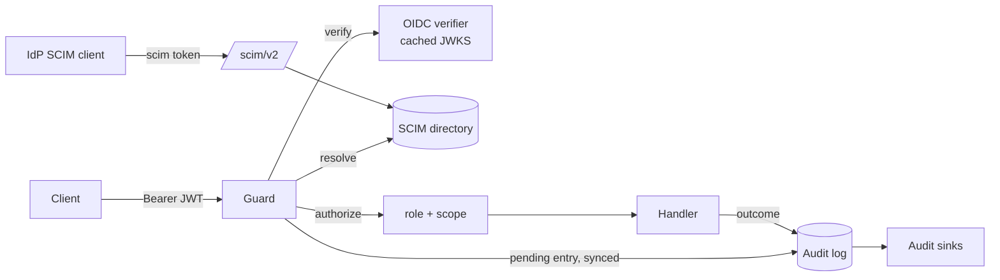

# Single sign-on, SCIM and the audit log

Three features, all **off by default** (a deployment that turns none of them
on behaves exactly as before):

| Feature | What it does | Switch |
| --- | --- | --- |
| **SSO** | The admin API (4002) and the route-management API (4003) accept `Authorization: Bearer <JWT from your OIDC identity provider>`, and map who you are to a role | `auth.enabled` |
| **SCIM 2.0** | Your identity provider (Okta, Microsoft Entra ID) provisions users and groups into a directory under `/scim/v2`; deactivating a user stops their tokens working | `scim.enabled` |
| **Audit log** | Every mutation and every denial on those APIs is written durably to the node's store, readable at `GET /v1/audit`, and shipped to sinks | `audit.enabled` |

Not covered: the ingest port (4000: providers authenticate by signing the
body) and the claim-check gateway (4001: workers redeem claims there, not
people). There is no browser login and no SAML: the credential is a bearer
token your identity provider already issues.



## Turning it on

```yaml
admin: {enabled: true, ip: 0.0.0.0}

auth:
  enabled: true
  oidc:
    issuer: https://login.example.com/
    audience: ankusa
  bindings:
    - {group: Platform, role: admin}
    - {group: Acme Ops, role: operator, tenants: [acme]}

scim:
  enabled: true
  token: "${ANKUSA_SCIM_TOKEN}"   # >= 32 bytes; openssl rand -base64 48

audit:
  enabled: true
  retention_days: 365
```

Every key, with its default and comment, is in
[`config-examples/reference.yml`](https://github.com/jamescarr/ankusa/blob/main/packages/ankusa_server/config-examples/reference.yml).
Embedding the library instead: `auth:`, `scim:` and `audit:` are sections of
`%Ankusa.Config{}` ([`configuration.md`](configuration.md)), and the OIDC
verifier is the `ankusa_oidc` package (`{Ankusa.Auth.OIDC, issuer: ..., audience: ...}`);
the `jamescarr/ankusa` image has it built in.

Bad configuration fails the boot, naming the key: a binding with both `group`
and `subject`, an unknown role, a tenant that is not `[A-Za-z0-9_-]{1,64}`, a
SCIM token under 32 bytes, `scim.enabled` without `auth.enabled`, `none` or
`HS*` signature algorithms.

## How a request is decided

`Ankusa.Admin.Guard` runs before every handler of both listeners:

1. **Classify.** The method and the path (as the router will match it,
   percent-decoding included) name an *action*, the role it needs, and its
   scope (`Ankusa.Admin.Actions`). `GET /health` and `GET /ready` are public.
   `/metrics` needs `viewer`.
2. **Verify.** The bearer token is checked by `auth.verifier`. For OIDC: signature
   against the provider's JWKS (cached, refreshed hourly and on an unknown
   `kid`), `iss` exactly, `aud`, `exp`, `nbf`, algorithm in an allowlist.
3. **Resolve.** The claims become a principal with grants (below).
4. **Authorize.** Some grant must have a role at least the action's and cover
   its scope.
5. **Audit.** A mutation is recorded `pending` (synced) *before* the handler
   runs, and completed from the response. If it cannot be recorded it does not
   run.

| Status | `error` | Meaning |
| --- | --- | --- |
| `401` | `unauthenticated` | no bearer token |
| `401` | `invalid_token` | the verifier rejected it |
| `403` | `forbidden` (+ `required_role`) | authenticated, but no grant covers the action |
| `403` | `user_not_provisioned` | SCIM is on and the token matches no directory user |
| `403` | `user_inactive` | the directory user is deactivated |
| `503` | `auth_unavailable` | the verifier has never fetched keys, or the directory is unreachable; the token is not judged, retry (`Retry-After: 1`) |
| `503` | `audit_unavailable` | the mutation's audit record could not be written; nothing changed |

### Roles

`viewer < operator < admin`; a higher role includes the lower.

| Role | May |
| --- | --- |
| `viewer` | every read, `/metrics`, the route dry run |
| `operator` | `viewer` + create/patch replays, purge the quarantine pen |
| `admin` | `operator` + create/update/delete sources, routes, the global IP rules, a tenant's rate limit; read the audit log |

Roles are global, or **scoped to tenants** (`tenants: [acme]`). A scoped grant
covers a tenant's own resources only: its sources and its audit trail. Anything
platform-wide (the DLQ, replays, the quarantine pen, route management, and a
tenant's rate limit, because a limit shapes the shared edge) needs a grant over
`all` tenants, the default.

### Bindings

A binding grants one role to a **group** or to one **subject**:

```yaml
bindings:
  - {group: Platform, role: admin}                       # everywhere
  - {group: Acme Ops, role: operator, tenants: [acme]}   # acme only
  - {subject: ci-deployer, role: viewer}                 # a machine identity
```

A group binding naming a group nobody is in grants nothing. Group names compare
exactly.

Where a token's groups come from:

* **With SCIM**: the directory. The token's `user_match.claim` (default
  `preferred_username`) is looked up as the user's `userName`
  (case-insensitively; `attribute: userName`) or `externalId` (exactly;
  `attribute: externalId`), and the user's groups are the directory groups they
  belong to; a binding names a group's `displayName`. An inactive user is
  refused whatever their token says, so deprovisioning takes effect
  immediately, not at token expiry. A `subject` binding still works for a token
  with no directory user: that is how a CI job gets in without being provisioned.
* **Without SCIM**: the token's `groups` claim (`auth.groups_claim`).

Identity-provider notes: Okta needs a groups claim added to the authorization
server before group bindings can work without SCIM. Microsoft Entra puts group
*object ids*, not names, in the `groups` claim, so without SCIM bind the ids,
and with SCIM provision the groups and bind their names. If your provider's
usable join key is `sub` or `oid` rather than the username, set
`user_match: {claim: oid, attribute: externalId}` and map Entra's `externalId`
to the object id. A token carrying neither claim is `user_not_provisioned`;
there is no fallback.

## SCIM

The identity provider's SCIM client calls `/scim/v2` on the admin listener with
the static token (`scim.token`). That token opens `/scim/v2` and nothing else,
and a user token does not open it. With `scim.enabled: false` the path is a `404`.

| | |
| --- | --- |
| Base URL to give the provider | `https://<admin host>/scim/v2` |
| Authentication | HTTP header, `Bearer <scim.token>` |
| Unique identifier | `userName` |
| Resources | `/Users`, `/Groups`, `/ServiceProviderConfig`, `/ResourceTypes`, `/Schemas` |

* **Filter**: `attr eq "value"` only: `userName`, `externalId`, `id` on users;
  `displayName`, `externalId`, `id` on groups. Okta's and Entra's lookups before
  a create work; a miss is an empty list. Anything else is `400 invalidFilter`.
* **`userName` and `displayName` are unique, case-insensitively**, and keep the
  casing they were sent in (`409 uniqueness`).
* **PATCH** supports `add`, `replace` and `remove`, with no path, an attribute,
  `attr.sub`, an enterprise-extension attribute, or a filtered path such as
  `emails[type eq "work"].value`; `active` accepts `"False"`. On groups,
  `members` and `members[value eq "<id>"]` (and Entra's remove-with-value-list)
  change membership **atomically**: concurrent provisioning runs cannot lose
  each other's members.
* Only the attributes of the User and Group schemas are kept; `id`, `meta`,
  `groups` and `password` in a body are ignored. Bodies are capped at 4 MiB.
* Not supported: bulk, sort, ETags, password changes.

### The directory

`scim.store.type: persistent` (the default) keeps users and groups in this
node's store: node-local, like the DLQ. Provisioning must reach the node that
authenticates admin requests, which means a single admin node. For a fleet use
`type: redis` (the `ankusa_redis` package): every node with the same namespace
shares one directory, and a deactivation reaches all of them at once. Nothing
is cached, so there is no stale window, and a Redis outage is `503`
(`auth_unavailable` for tokens, a retryable `503` for SCIM), never a `403`.

## The audit log

**What is recorded**: every mutation and every denial (`401`, `403`) on 4002,
4003 and `/scim/v2`. Not reads, not `/health`, and never request bodies (a
source's spec carries credentials).

```json
{
  "id": "01a13849-53a6-71ab-bc77-b80cbcedd1e1",
  "at": 1791945692070, "time": "2026-10-14T02:41:32.070Z",
  "instance": "default", "listener": "admin",
  "action": "source.create", "outcome": "success", "status": 201,
  "method": "POST", "path": "/v1/tenants/acme/sources",
  "tenant": "acme", "target": "acme.stripe",
  "actor": {"type": "user", "subject": "u-123", "username": "ada",
            "user_id": "…", "ip": "10.0.0.7"},
  "request_id": "req-1"
}
```

`outcome` is `success` (2xx), `failure` (the handler refused), `error` (it
crashed: the change may or may not have happened), `denied`, or `pending` (the
outcome was never recorded, because the node died mid-request). Actions are
named `source.create`, `replay.update`, `route.delete`, `rate_limit.put`,
`quarantine.purge`, `scim.user.update`, `scim.group.create`, `audit.list`... the
whole table is `Ankusa.Admin.Actions`. `actor.type` is `user`, `service` (a
subject binding with no directory user), `scim`, or `anonymous` (auth is off, or
no valid credential). The IP is the peer address; `X-Forwarded-For` is not trusted.

**Fail closed.** The `pending` row is written and synced before the handler
runs. If the node's store cannot take it, the request is `503
audit_unavailable` and the change is not made.

**Reading it**: `GET /v1/audit` (needs `admin` over all tenants) and
`GET /v1/tenants/{tenant}/audit` (a tenant-scoped admin may read its own), newest
first, filtered by `tenant`, `action`, `actor` (subject or username), `outcome`,
`since`, `until`, paged with `limit` and `next_cursor`. The log is node-local:
ask each node you ran requests against.

**Shipping it**: `audit.sinks` takes the same sink types as a source. Each entry
is delivered **at least once and in order**, as a CloudEvent
(`io.ankusa.audit.<action>`, `id` = the entry id, so a consumer can drop
duplicates), with a cursor per sink kept in the store so a restart resumes. A
failing sink is retried with the `dispatch.retry` backoff and never skips an
entry; one sink's trouble does not hold another back. If you reorder or replace
sinks the new one starts from the oldest retained entry. `ankusa:audit` is a
reserved source id.

**Retention**: `audit.retention_days` (default 365, `null` keeps everything).
Entries older than that are deleted hourly, but never ahead of the slowest sink's
cursor.

Order is exact within a node (entries made in the same millisecond keep the
order they were made in); across nodes it is by clock.

## Observing it

| Metric | Labels | |
| --- | --- | --- |
| `ankusa.auth.denied.total` | `instance`, `reason` | `unauthenticated`, `invalid_token`, `forbidden`, `user_not_provisioned`, `user_inactive`, `auth_unavailable`, `scim_token` |
| `ankusa.audit.write_failures.total` | `instance` | an entry could not be written (a mutation was refused, or an entry stayed `pending`) |
| `ankusa.audit.ship_failures.total` | `instance`, `sink` | a delivery to an audit sink failed |

Telemetry events: `[:ankusa, :auth, :denied]`, `[:ankusa, :audit, :recorded]`,
`[:ankusa, :audit, :write_failed]`, `[:ankusa, :audit, :shipped]`,
`[:ankusa, :audit, :ship_failed]`.

## Operating notes

* **Rotate the SCIM token** by changing `scim.token` and the identity provider's
  copy together; a restart picks it up.
* **IdP key rotation** needs nothing: a token with an unknown `kid` triggers one
  key refresh (at most one a minute).
* **The identity provider is down at boot**: the node starts; tokens are
  `503 auth_unavailable` until the first key fetch succeeds (retried every 30 s).
* **Locked out?** Set `auth.enabled: false` and restart: the listeners are
  open again. Keep the admin ports on a private network regardless.
* **Denials are recorded too, and synced.** Whoever can reach an admin port can
  make the log grow (a `401` is one small entry, written durably before the
  answer): another reason to keep 4002 and 4003 off the public internet, and
  to set `audit.retention_days` to what you will actually read.
* `/v1/config` redacts `scim.token` and every secret in an adapter's options;
  `auth.oidc.issuer` and `audience` are shown.
