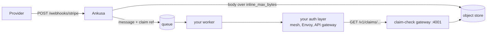

# Claim check

Webhook bodies can be megabytes; queue messages shouldn't be. When a RabbitMQ,
Kafka, NATS, Redis, SQS or Google Cloud Pub/Sub sink gets a body larger than
its `inline_max_bytes` (64 KiB by default), Ankusa writes the body to the
object store and publishes a small **reference** in its place. Your worker turns the reference into an HTTP GET
and gets the exact bytes back, with an HTTP client and nothing else: no
Elixir, no cloud SDK, no object-store credentials.



The machine-readable contract is
[`claim_check.v1.yaml`](https://github.com/jamescarr/ankusa/blob/main/packages/ankusa/priv/openapi/claim_check.v1.yaml)
(OpenAPI 3.1). Generate your client from it; this page explains how to use it.

## The reference

A queue message carries either `body_base64` or a `claim` plus its `sha256`
([full message format](delivery.md#sinkrabbitmq-queue-delivery)):

```json
{"claim": "urn:ankusa:claim:v1:acme:01M39VMD8RA3C5HR4RBV67Y002",
 "sha256": "3bea8a9a07c1e8dcaa4c1b816815c35a29b4fb585ba6ecc70ea44840a794cfb3"}
```

```
urn:ankusa:claim:v1:acme:01M39VMD8RA3C5HR4RBV67Y002
                    └┬─┘ └─────────┬──────────────┘
                   tenant       claim id
```

| Field | Meaning |
| --- | --- |
| `tenant` | `[A-Za-z0-9_-]{1,64}`. The same string in the reference, the URL, and the storage key, no encoding anywhere. |
| `claim id` | A [ULID](https://github.com/ulid/spec) in canonical form: 26 uppercase Crockford base32 characters. The first 48 bits are the time the claim's pack was written; the last 16 are the claim's position in that pack. Several claims share one pack (see [Write cost](#write-cost)). |
| `sha256` | A message field next to `claim`, not part of the reference: the lowercase hex digest of the claim's bytes. The reader checks it. |

A reference names no bucket or URL, and the gateway wants a credential on top
of it ([Run the gateway](#run-the-gateway)). A v1 reference never expires, and
no secret binds it: a leaked message is good for every read its reader's
credential allows until the claim is swept. You turn it into a request by
dropping the prefix:

```
urn:ankusa:claim:v1:acme:01M39VMD8RA3C5HR4RBV67Y002
                    → GET /v1/claims/acme/01M39VMD8RA3C5HR4RBV67Y002
```

### Signed, expiring references (v2)

Set `claim_check.ref_signing_keys` and every claim written is handed back as a
**v2** reference, which expires and cannot be forged or retargeted at another
tenant:

```
urn:ankusa:claim:v2:acme:01M39VMD8RA3C5HR4RBV67Y002:1790345000:MAmydaNzNwA3sV38ggZG15ElUTajA8QtBkKevsaq1Ac
                    └┬─┘ └─────────┬──────────────┘ └───┬────┘ └────────────────────┬────────────────────┘
                   tenant       claim id          exp_unix            signature
```

| Field | Meaning |
| --- | --- |
| `exp_unix` | The Unix second the reference stops working: decimal, 1 to 12 digits, no leading zero. `claim_check.ref_ttl_ms` after the claim was written; unset, the retention window (`claim_check.retention_days`), else 30 days. |
| `signature` | 43 unpadded base64url characters: the HMAC-SHA256, under the first of `ref_signing_keys`, of `urn:ankusa:claim:v2:<tenant>:<claim_id>:<exp_unix>`. Changing the tenant, the claim id or the expiry breaks it. |

The signed proof rides the request as two query parameters, in this order:

```
urn:ankusa:claim:v2:acme:01M39VMD8RA3C5HR4RBV67Y002:1790345000:MAmydaNzNwA3sV38ggZG15ElUTajA8QtBkKevsaq1Ac
   → GET /v1/claims/acme/01M39VMD8RA3C5HR4RBV67Y002?exp=1790345000&sig=MAmydaNzNwA3sV38ggZG15ElUTajA8QtBkKevsaq1Ac
```

Every SDK's `parse_claim_ref` does that for you and hands `redeem` the path
with its query. SDKs never check the signature or the clock: only the
gateway (and `redeem/3` on a node that has the keys) holds the key. The
gateway answers, after it has authenticated and authorized the caller and
before it reads anything, `400 bad_signature` for a signature no listed key
produced (or an `exp` or `sig` missing one, or out of grammar) and `410
ref_expired` for a good signature past its `exp`. A tampered `exp` is
`bad_signature`, never `ref_expired`.

**Rotating a key.** `ref_signing_keys` is `[current, previous...]`: new
references are signed with the first, and one signed with any listed key is
served. Put the new key in front on every claim-writing node and on the
gateway, and drop the old key once every reference it signed has expired
(`ref_ttl_ms` after the last deploy of the old key). The same keys must be
configured on every claim-writing node and on every gateway.

**Turning signing on.** The gateway then refuses a v1 reference with `400
unsigned_ref`, because a v1 reference cannot be told from a forgery.
References already sitting in queues are v1: set
`claim_check.accept_unsigned_refs: true` while they drain, then remove it.
With no keys, nothing changes: references stay v1 and are served.

## Run the gateway

The gateway is the `claim_check` role of the same image, and it is read-only:
no writes, no listing, no delete. It reads the same `storage` block as the
nodes that write claims, and needs no store:

```yaml
node:
  roles: [claim_check]

storage:
  type: s3
  s3:
    bucket: "${S3_BUCKET}"
    region: "${S3_REGION}"

claim_check:
  port: 4001            # [env ANKUSA_CLAIM_CHECK_PORT]
  ip: 0.0.0.0           # [env ANKUSA_CLAIM_CHECK_IP] default 127.0.0.1; consumers on other hosts need 0.0.0.0
  pack_max_bytes: 16777216
```

```sh
docker run -p 127.0.0.1:4001:4001 \
  -v "$PWD/ankusa.yml:/etc/ankusa/ankusa.yml" \
  -e S3_BUCKET -e S3_REGION -e AWS_ACCESS_KEY_ID -e AWS_SECRET_ACCESS_KEY \
  jamescarr/ankusa:edge
curl localhost:4001/health    # {"status":"ok"}
```

A single container can run it next to the other roles
(`roles: [edge, dispatch, storage, claim_check]`), as
[`rabbitmq-fanout.yml`](https://github.com/jamescarr/ankusa/blob/main/packages/ankusa_server/config-examples/rabbitmq-fanout.yml)
does. Either way, keep port 4001 on your internal network: it serves webhook
payloads.

**The gateway's credential needs read and list.** On S3 that is
`s3:GetObject` *and* `s3:ListBucket` on the bucket: without `ListBucket`, S3
answers a missing key with `403`, not `404`, and an expired claim would look
like a permission problem. A `403` from the store is answered
`503 store_forbidden` with `Retry-After: 60` — retryable, because a fixed
policy makes the same request succeed.

### A dedicated claim store

Claims go to the `storage` bucket by default. `claim_check.store` (same shape
as `storage`: `type: local|s3|gcs`, its `s3:`/`gcs:` block, plus `root` for
`local`) sends them somewhere else — a bucket with its own lifecycle rule and
its own read-only policy for the gateway:

```yaml
claim_check:
  store:
    type: s3
    s3:
      bucket: "${CLAIMS_BUCKET}"
      region: "${S3_REGION}"
```

Set it the same on every node that writes claims and on the gateway. Claim
keys never take `storage.key_prefix` (claim ids are already unique), so one
gateway serves claims written by every node of a fleet. A gateway-only node
whose claim store is `local` logs a warning at boot: it reads its own disk, and
other nodes' claims are only there if that directory is shared.

### Several stores, and failover

`claim_check.stores` lists claim stores in order, each in the `store` shape
(the two keys are exclusive). Buckets, regions and providers can mix:

```yaml
claim_check:
  stores:
    - type: s3
      s3: {bucket: "${CLAIMS_BUCKET}", region: us-east-1}
    - type: s3
      s3: {bucket: "${CLAIMS_BUCKET_WEST}", region: us-west-2}
  placement: ordered        # or hash
  store_cooldown_ms: 30000
```

- `placement: ordered` (default): every pack goes to the first store; the
  next ones take packs only while it fails.
- `placement: hash`: the pack id's random bits pick a store, so packs, and
  their request rate, spread evenly over all of them; the next stores take
  over while a pack's store fails.

A pack write that still fails after the store's own retries moves to the next
store at once, and later writes skip the failed store for
`store_cooldown_ms`, then try it again. Only when every store fails does the
write fail, and the delivery is retried under the sink's retry policy, the
same as with one store. The gateway searches every store, so a pack a failover
put elsewhere is still served. A store that can't answer a read is searched
last for `store_cooldown_ms` too, so on a gateway that never writes, a hung
store costs one read its timeout and the next reads go to the healthy stores
first. A claim no store has is `404` only when every store answered: if one
couldn't, the answer is `503 store_unavailable`, because the claim may be in
it.

Set the same list, in the same order, on every node that writes claims and on
the gateway. Adding a store is safe: with `hash` new packs spread onto it, and
older ones are still found. **Removing a store makes the claims in it
unreadable**; remove one only once its packs are past retention. Each store
needs its own lifecycle rule (see [Retention](#retention)).

**The gateway authenticates and authorizes every read** (`claim_check.auth`, see
[Control-plane authentication](configuration.md#control-plane-authentication)):
`401` without an accepted credential (bearer token, OIDC access token or client
certificate), `403` unless the caller holds `claims:read` and the claim's
tenant (`tenant:<tenant_id>` or `tenant:*`). `mode: none` is accepted on
loopback only, or with `allow_insecure: true` when a service mesh, Envoy or an
API gateway in front authenticates every caller; the node logs a warning at
startup when it has no authentication of its own. Readers send the credential
as `Authorization: Bearer` (the TypeScript client's `headers` option, the Elixir
SDK's `:headers`).

### Under load

The gateway keeps answering fast while an object store throttles or hangs:

- **From memory.** Pack indexes and claims it has read are cached, up to
  `read_cache_bytes`; a claim over `read_cache_max_entry_bytes` is served and
  never cached, and partial ranges never are. A pack's first read covers its first
  1 024 claims, so the rest of the pack is located without the store. Claims
  never change, so nothing cached is wrong while the claim exists; a claim
  swept by retention can still answer `HEAD` for up to 10 minutes, and `GET`
  for up to 2.
- **One store read per claim.** Concurrent requests for one claim, one
  pack's index, or one pack's manifest share one store read.
- **An adaptive limit.** Per store, concurrent reads are capped at a limit
  that starts at `read_max_inflight`, halves when the store throttles (`429`,
  `503 SlowDown`) or doesn't answer, and grows back by one per round of
  successes. Reads past it wait in a queue of `read_queue_max`; past that,
  they get `503` at once.
- **A deadline.** Every request is answered within `read_deadline_ms`, well
  inside the SDKs' 10 s request timeout: past it, `503 store_unavailable`. A
  store read that outlives the deadline still finishes and fills the cache,
  so the client's retry is served from memory. Store requests use
  `read_timeout_ms` and `read_retries`, not the store's write timeouts, and a
  store that couldn't answer isn't asked again at the other key layout within
  the same read.
- **A cap on the node.** Past `max_concurrent_reads` (1024) requests in flight
  on one gateway, the next is `503 overloaded` with the same `Retry-After`, before
  it locates anything: cache hits count, so a flood of cheap reads can't
  starve the node. `0` is no cap.

```yaml
claim_check:
  read_deadline_ms: 5000
  read_timeout_ms: 3000
  read_retries: 1
  read_max_inflight: 48       # per store; under the HTTP client's 50 connections
  read_queue_max: 256         # per store; 0 = never wait
  read_cache_bytes: 134217728 # 0 = no cache
  read_cache_max_entry_bytes: 1048576
```

A throttling store never opens its breaker: it answered, and the limit is what
backs off. Every `503 store_unavailable` carries a `Retry-After` of 1 to 3
seconds, picked at random, so the clients one throttle turned away don't come
back together. On `/metrics`:
`ankusa_claim_gateway_requests_total{status}` and
`ankusa_claim_gateway_duration_seconds` (the status is the only label: no
tenant, claim or method); `ankusa_claim_sweeps_total{deleted}` (one per sweep
tick, `deleted="true"` when it removed a partition, a pack or a lease row);
`ankusa_claim_check_reads_total{kind,source,result}`, where `kind` is `index`,
`manifest`, `bytes` or `range`, `source` is
`cache`, `store`, `coalesced`, `shed` or `direct` (a node reading without
the gateway's reader) and `result` tells `throttled`, `unavailable`,
`overloaded` (shed by the queue), `deadline` (shed at the deadline) and
`integrity_mismatch` apart; and
`ankusa_claim_check_read_limit`, `_read_inflight` and `_read_queued` per
store.

## Redeem a claim

```
GET /v1/claims/{tenant}/{claim_id}
```

A `200` returns exactly the claim's bytes, as `application/octet-stream`,
with `cache-control: private, max-age=31536000, immutable` and
`accept-ranges: bytes`. Claims are written once and never rewritten, so a
client may cache them forever; `private` keeps a shared cache from storing one
tenant's payload. `HEAD` on the same path answers the same status and
`content-length` with no body, and reads only the pack's index.

A `Range` header with one byte range — `bytes=0-1023`, `bytes=1024-`, or
`bytes=-1024` for the last 1 KiB — gets `206` with those bytes and
`content-range: bytes 0-1023/<length>`, read from the object store as one
ranged read; an end past the claim is clamped to it. A range that starts at or
past the end is `416` with `content-range: bytes */<length>`. Several ranges,
another unit, a malformed spec, or any `If-Range` are ignored and get the
whole claim (`200`). The sha256 covers the whole claim, so check it once the
ranges are reassembled. Responses are not streamed: each is read into memory
whole, which a claim's `max_body_bytes` bound keeps finite.

### Integrity

Every pack carries a manifest with each claim's sha256, and the gateway
(`claim_check.integrity_check: manifest`, the default) holds what it serves
to it. A whole-claim `GET` whose bytes don't match is `502 integrity_mismatch`
and sends none of them; so is any `GET` from a pack whose manifest doesn't
parse or doesn't list exactly the pack's claims. `200` and `206` carry the
digest as `x-ankusa-sha256` (lowercase hex of the whole claim), so a client
that reassembles ranges can check what it assembled. A `Range` is not checked
by the gateway, only handed the digest; `HEAD` reads only the pack's index
and carries none.

The manifest is read once per pack, the first time one of its claims is
requested (one ranged read, a second for a manifest larger than the first
read guessed), shared by every concurrent request, and kept in the pack's
cache entry: 32 bytes a claim, inside `read_cache_bytes`, aging out with the
pack's index. With `read_cache_bytes: 0` there is nowhere to keep it, so
every `GET` reads it again; set `integrity_check: off` there, which serves
the store's bytes unchecked and sends no digest.

The manifest is the store's own record of the bytes, so this catches
damage in the store or on the way back, not a body replaced together with
its manifest. The message's `sha256` is the writer's digest of the bytes and
covers that too: compare the bytes' sha256 against it before you use them,
and treat a mismatch as permanent.

```sh
curl -fsS http://claim-check:4001/v1/claims/acme/01M39VMD8RA3C5HR4RBV67Y002 -o body.bin
shasum -a 256 body.bin    # must equal the message's sha256 (and x-ankusa-sha256)
```

### Responses

Errors are JSON: `{"error": "not_found"}`.

| Status | `error` | Cause | Retry? |
| --- | --- | --- | --- |
| `200` |  | the bytes, cacheable forever by the client |  |
| `206` |  | the requested `Range` of the bytes |  |
| `400` | `invalid_tenant`, `invalid_id` | tenant outside `[A-Za-z0-9_-]{1,64}`; claim id not a canonical ULID | No, a bug |
| `400` | `bad_signature` | a [v2 reference](#signed-expiring-references-v2) whose `exp`/`sig` is missing one, out of grammar, or not what any `ref_signing_keys` entry signed for this tenant, claim and expiry | No, dead-letter |
| `400` | `unsigned_ref` | a v1 reference (no `exp`/`sig`) while the gateway refuses unsigned references | No: re-deliver the hook for a v2 one |
| `401` | `unauthenticated` | no credential, or one that is wrong or expired | After fixing the reader's credential |
| `403` | `forbidden` | the credential lacks `claims:read` or the path's tenant (`scope` names it), or `claim_check.authorize` refused | After fixing the reader's credential |
| `404` | `not_found` | no such claim: expired by retention, or never written | No, dead-letter |
| `410` | `ref_expired` | a v2 reference with a good signature, past its `exp` | No, dead-letter: re-deliver the hook for a fresh one |
| `416` |  | the `Range` starts past the claim's end; `content-range: bytes */<length>` | No, fix the range |
| `408`, `429` |  | a front layer (proxy, API gateway) timing out or throttling | Yes, retry |
| `503` | `store_unavailable` | the object store is unreachable, throttling, or slower than the gateway's deadline, or the gateway is shedding load; `Retry-After` 1–3, random | Yes |
| `503` | `overloaded` | this node already serves `claim_check.max_concurrent_reads` requests; `Retry-After` 1–3, random | Yes |
| `503` | `store_forbidden` | the object store refused the gateway's credential; `Retry-After: 60` | Yes, after fixing the policy |
| `502` | `integrity_mismatch` | the bytes the store returned (or the pack's manifest) don't match the sha256 the pack's manifest records for this claim; see [Integrity](#integrity) | No, dead-letter: the claim is damaged in the store (the SDKs retry any `5xx` a few times before they give up) |
|  |  | bytes don't match the message's sha256 (your check) | No, dead-letter |

The `503` body is only the `error` code; the store's own error (which can name
the bucket) goes to the gateway's log.

Redeeming doesn't delete. Several consumers can redeem one claim, every queue
bound to a fanout exchange, say, and claims go away only through
[retention](#retention).

### Who may redeem

Reading a claim needs a credential (`claim_check.auth`, see
[Control-plane authentication](configuration.md#control-plane-authentication))
holding `claims:read` **and** the tenant of the path as `tenant:<tenant_id>`
(or `tenant:*`): a tenant-A credential on a tenant-B path is `403`, before
anything is read. To decide differently (an ownership table, a policy
service), set `claim_check.authorize` to a `{module, fun, args}`: the gateway
calls `apply(module, fun, [context | args])` after authenticating the caller
and before it locates the claim, with
`context = %{principal: %Ankusa.Principal{}, tenant_id: ..., claim_id: ..., conn: %Plug.Conn{}}`
(the two path segments as sent, not yet validated). Return `:ok` to serve it;
anything else is `403 forbidden`. The hook replaces the built-in check, so it
must also decide what a missing scope means. It runs in the request process
and on every request: keep it fast and free of side effects.

### What a front layer needs

The whole integration surface for auth is one method and one path shape:

```
^/v1/claims/[A-Za-z0-9_-]{1,64}/[0-7][0-9A-HJKMNP-TV-Z]{25}(\?exp=[1-9][0-9]{0,11}&sig=[A-Za-z0-9_-]{43})?$
```

Anything else can be refused at the edge. The tenant is a path segment, so an
authorizer compares it to the caller's identity without reading a body. One
rule matters more than the rest: **a shared cache must sit behind the
authorizer, never in front of it**. A cache in front would serve one tenant's
payload to another tenant's request; the gateway's `cache-control: private`
tells a standards-following shared cache not to store claims at all.

### From TypeScript, with the SDK

[`packages/sdk-typescript`](https://github.com/jamescarr/ankusa/tree/main/packages/sdk-typescript)
(npm package `ankusa`) wraps a client generated from the spec with
`openapi-typescript` + `openapi-fetch`: it parses a ref, redeems it, and
verifies the bytes against the message's sha256 before returning them: the
gateway does not check this itself. It's the framework's own
umbrella client package: the claim-check client is the first piece in it.

```sh
npm install ankusa   # or, before its first npm release, a `file:` path
                      # dep, see the package README
```

```typescript
import { ClaimCheckError, createClaimCheckClient } from "ankusa";

const claimCheck = createClaimCheckClient({ baseUrl: process.env.CLAIM_CHECK_URL ?? "http://localhost:4001" });

// claim and sha256 are the queue message's fields.
async function redeemClaim(claim: string, sha256: string): Promise<Buffer> {
  return claimCheck.redeem(claim, sha256);
}
```

Every failure is a `ClaimCheckError` with a `retryable` boolean: `false` for
a malformed ref, `404`, other `4xx`, or an integrity mismatch; `true` for
`5xx`/`503` or an unreachable gateway. So sorting a redeem failure into
dead-letter vs. retry needs no status-code knowledge. The workers in
[`rabbitmq-consumer`](https://github.com/jamescarr/ankusa/tree/main/examples/rabbitmq-consumer/worker)
and
[`kafka-sqs-consumer`](https://github.com/jamescarr/ankusa/tree/main/examples/kafka-sqs-consumer/worker)
depend on it.

### From Python, with the SDK

[`packages/sdk-python`](https://github.com/jamescarr/ankusa/tree/main/packages/sdk-python)
(PyPI package `ankusa`) ships a `ClaimCheckClient` built on
[`httpx`](https://www.python-httpx.org/) against the same contract: it
parses a ref, redeems it, and verifies the bytes against the message's sha256
before returning them, the same end-to-end check the TypeScript client runs
and the gateway itself does not. It's the umbrella client
package for non-Elixir consumers: the claim-check client is the first piece
in it, alongside a webhook header-parsing helper for the HTTP-sink side.

```sh
pip install ankusa   # or, before its first PyPI release, a uv/pip local
                      # path dep, see the package README
```

```python
import os

from ankusa import ClaimCheckClient, ClaimCheckError

claim_check = ClaimCheckClient(os.environ.get("CLAIM_CHECK_URL", "http://localhost:4001"))

# claim and sha256 are the queue message's fields.
def redeem_claim(claim: str, sha256: str) -> bytes:
    return claim_check.redeem(claim, sha256)
```

Every failure is a `ClaimCheckError` subclass with a `retryable` attribute:
`False` for a malformed ref, `404`, other `4xx`, or an integrity mismatch;
`True` for `5xx`/`503` or an unreachable gateway, the same dead-letter vs.
retry split as the TypeScript client.

### From Rust, with the crate

[`packages/sdk-rust`](https://github.com/jamescarr/ankusa/tree/main/packages/sdk-rust)
(crates.io crate `ankusa`) ships the same client as an async crate on
[`reqwest`](https://docs.rs/reqwest) and Tokio (every request is bounded by
`tokio::time::timeout`): it parses a
ref, redeems it, and verifies the bytes against the message's sha256 before
returning them. It's the umbrella client crate for Rust consumers, alongside
the webhook header helper and the route-management and operator clients.

```sh
cargo add ankusa
```

```rust
use ankusa::ClaimCheckClient;

let claim_check = ClaimCheckClient::new("http://localhost:4001")?;

// `claim` and `sha256` are the queue message's fields.
let bytes = claim_check.redeem(claim, sha256).await?;
```

Every failure is a `ClaimCheckError`, and `is_retryable()` splits it the same
way: `false` for a malformed ref, `404`, other `4xx`, or an integrity
mismatch; `true` for `5xx`/`503`, an unfollowed redirect, or an unreachable
gateway.
### From PHP, with the SDK

[`packages/sdk-php`](https://github.com/jamescarr/ankusa/tree/main/packages/sdk-php)
(Packagist package `jamescarr/ankusa`) ships the same three pieces on top of
PSR-18 (`guzzlehttp/guzzle` by default, any PSR-18 client injected): a
`ClaimCheckClient` that parses a ref, redeems it, and verifies the bytes against
the message's sha256, a webhook header helper for the HTTP-sink side, and
clients for the routes, admin and source APIs.

```sh
composer require jamescarr/ankusa   # or, before its first Packagist release,
                                    # a path repository, see the package README
```

```php
use Ankusa\ClaimCheck\ClaimCheckClient;
use Ankusa\ClaimCheck\ClaimCheckError;

$claimCheck = new ClaimCheckClient(getenv('CLAIM_CHECK_URL') ?: 'http://localhost:4001');

// $claim and $sha256 are the queue message's fields.
$body = $claimCheck->redeem($claim, $sha256);
```

Every failure is a `ClaimCheckError` whose `isRetryable()` returns `false` for a
malformed ref, `404`, other `4xx` or an integrity mismatch, and `true` for
`5xx`/`503` or an unreachable gateway.

### From Ruby, with the SDK

[`packages/sdk-ruby`](https://github.com/jamescarr/ankusa/tree/main/packages/sdk-ruby)
(RubyGems gem `ankusa-sdk`) ships an `Ankusa::ClaimCheckClient` against the same
contract: it parses a ref, redeems it, and verifies the bytes against the
message's sha256 before returning them, the same end-to-end check the
TypeScript, Python, and Rust clients run and the gateway itself does not. It's
the umbrella client package for Ruby: the claim-check client sits alongside the
routes, admin, and sources clients and a webhook header-parsing helper.

```sh
gem install ankusa-sdk   # or, before its first RubyGems release, a path dep,
                          # see the package README
```

```ruby
require "ankusa/sdk"

CLAIM_CHECK = Ankusa::ClaimCheckClient.new(ENV.fetch("CLAIM_CHECK_URL", "http://localhost:4001"))

# claim and sha256 are the queue message's fields.
def redeem_claim(claim, sha256)
  CLAIM_CHECK.redeem(claim, sha256)
end
```

Every failure is a `ClaimCheckError` subclass with a `retryable?` method:
`false` for a malformed ref, `404`, other `4xx`, or an integrity mismatch;
`true` for `5xx`/`503` or an unreachable gateway, the same dead-letter vs.
retry split as the TypeScript and Python clients.

### From Elixir, with the SDK

[`packages/sdk-elixir`](https://github.com/jamescarr/ankusa/tree/main/packages/sdk-elixir)
(Hex package `ankusa_sdk`) ships an `Ankusa.SDK.ClaimCheck` against the same
contract: it parses a ref, redeems it, and verifies the bytes against the
message's sha256 before returning them, the same end-to-end check the other
clients run and the gateway itself does not. It is the umbrella package for
Elixir consumers: alongside the claim-check client sit `Ankusa.SDK.Receiver`
(the `Plug` for HTTP-sink deliveries) and the routes, admin, and sources
clients.

```elixir
# mix.exs: {:ankusa_sdk, "~> 0.5"}
claim_check = Ankusa.SDK.ClaimCheck.new(ENV.fetch("CLAIM_CHECK_URL", "http://localhost:4001"))

case Ankusa.SDK.ClaimCheck.redeem(claim_check, claim, sha256) do
  {:ok, body} -> handle(body)
  # bad ref/sha256, 404, or an integrity mismatch: dead-letter, don't requeue
  {:error, %{retryable: false} = error} -> dead_letter(error)
  # gateway unreachable or 5xx: safe to retry
  {:error, %{retryable: true} = error} -> requeue(error)
end
```

Every failure carries `retryable`: `false` for `InvalidClaimRefError`,
`ClaimNotFoundError`, `ClaimRejectedError` (other `4xx`, with `:status` and
`:body`) and `ClaimIntegrityError`; `true` for `ClaimCheckUnavailableError`
(`5xx`/`503` or unreachable).

### From Java, with the SDK

[`packages/sdk-java`](https://github.com/jamescarr/ankusa/tree/main/packages/sdk-java)
(Maven Central `io.github.jamescarr:ankusa-sdk`, Java 17+) ships a
`ClaimCheckClient` on the JDK's own `HttpClient` against the same contract: it
parses a ref, redeems it, and verifies the bytes against the message's sha256
before returning them. Alongside it sit a webhook header helper and the routes,
admin, and sources clients.

```java
import io.github.jamescarr.ankusa.claimcheck.ClaimCheckClient;

ClaimCheckClient claimCheck = new ClaimCheckClient("http://localhost:4001");

// claim and sha256 are the queue message's fields.
byte[] body = claimCheck.redeem(claim, sha256);
```

Every failure is an unchecked `ClaimCheckError` whose `retryable()` returns
`false` for a malformed ref, `404`, other `4xx` or an integrity mismatch, and
`true` for `5xx`/`503`, an unfollowed redirect, or an unreachable gateway.

### From Clojure, with the SDK

[`packages/sdk-clojure`](https://github.com/jamescarr/ankusa/tree/main/packages/sdk-clojure)
(Clojars `io.github.jamescarr/ankusa-clj`, Java 17+) ships an
`ankusa.sdk.claim-check` client on the JDK's own `HttpClient` against the same
contract: it parses a ref, redeems it, and verifies the bytes against the
message's sha256 before returning them. Alongside it sit a webhook header
helper, a queue-message decoder, and the routes, admin, and sources clients.

```clojure
(require '[ankusa.sdk.claim-check :as claim-check])

(def gateway (claim-check/client "http://localhost:4001"))

;; claim and sha256 are the queue message's fields.
(claim-check/redeem gateway claim sha256) ; => byte[]
```

Every failure is an `ex-info` whose `:retryable` (read it with
`ankusa.sdk.errors/retryable?`) is `false` for a malformed ref, `404`, other
`4xx` or an integrity mismatch, and `true` for `5xx`/`503`, an unfollowed
redirect, or an unreachable gateway.

### Any other language

Any OpenAPI generator, `openapi-generator`, `openapi-python-client`, works
against the same
[`claim_check.v1.yaml`](https://github.com/jamescarr/ankusa/blob/main/packages/ankusa/priv/openapi/claim_check.v1.yaml).

## Write cost

Object stores bill per write: S3 Standard and GCS regional Standard both charge
around $0.005 per 1,000 writes, and reads are $0.0004 per 1,000. Only bodies
over a sink's `inline_max_bytes` become claims at all, and dispatch writes them
**once per envelope** (it used to write per sink and per retry). Under
`wal.type: none` the request process is the writer (`Ankusa.Edge.Publish`) and
it keeps the same property: one check-in per envelope, before the first sink
runs, shared by every sink of that source. Two more levers keep writes cheap:

- **The threshold is configurable per sink.** The 64 KiB default is chosen so
  most webhook bodies ride inline: base64 turns it into about 88 KiB, under
  Kafka's 1 MiB `max.message.bytes` and SQS's 1 MiB. Raise or lower
  `inline_max_bytes` per sink; the cost moves to broker bytes.
- **Claims are packed.** Dispatch claims up to `dispatch.batch` (128) delivery
  rows per store scan, checks each batch's claims in per tenant as one object,
  and gives every hook a byte range inside it: one `PUT` per tenant per batch
  instead of one per hook, with no added latency (the batch is already in
  hand). A group bigger than `claim_check.pack_max_bytes` (16 MiB default)
  splits into several objects; a body bigger than that gets an object of its
  own. The `PUT` is **conditional** (`put_if_absent`: S3 and Azure
  `If-None-Match: *`, GCS `ifGenerationMatch=0`, OCI `if-none-match: *`): a pack id
  a store already holds an object under is refused, and the pack is written again
  under a fresh id (at most 3 attempts; each refusal emits `[:ankusa, :claim_check,
  :pack_collision]`), so a reused id can never overwrite claims that are already
  referenced. The whole check-in shares one deadline
  (`op_deadline_ms` of the claim stores, 120 s by default): a store that is slow
  or throttles with a `Retry-After` that does not fit costs a dispatch task at
  most that long, and the batch's items fail with
  `{:unavailable, {:throttled, seconds}}` for dispatch's own backoff.

Packs never mix tenants, so the write count is one per *tenant present* in a
batch. A tenant with thousands of distinct values, an account id say, keeps
every tenant's claims in objects of its own, which is what lets you delete
one tenant's data by deleting one prefix; the cost is that a batch spread
across 128 accounts is 128 writes, the "one object per claim" column below.

| Fat hooks/day | One object per claim | 32 claims per object |
| --- | --- | --- |
| 100k | ~$15/month | ~$0.47/month |
| 1M | ~$150/month | ~$4.69/month |
| 10M | ~$1,500/month | ~$46.88/month |

### Pack format

Every claim object is an uncompressed ZIP, in this order:

1. `index.bin`: one 8-byte row per claim, in position order: the byte offset
   of the claim's bytes in the pack and their length, each a big-endian
   unsigned 32-bit integer.
2. One entry per claim, named by its claim id.
3. `manifest.json`: each claim's claim id, hook id, offset, length, digest,
   content type, and receive time.

The gateway serves a claim with two ranged reads: the start of the pack
through the claim's index row, then the claim's bytes (or the requested range
of them; `HEAD` stops after the first). The index comes first
so no read needs the pack's size. `unzip`, Python's `zipfile`, Java, Go, and
Erlang all read the pack with no Ankusa code, through the ZIP central
directory at the end. Entries stay uncompressed because a compressed entry
has no raw byte range to serve.

## Storage layout

Claims live at

```
claims/tenant=acme/dt=2026-09-24/01M39VMD8RA3C5HR4RBV67Y000
```

in the claim store (the storage bucket unless `claim_check.store` or
`claim_check.stores` is set), beside the `archive/` segments and never under
`storage.key_prefix`. The last segment is the pack id: any of its claim ids
with the position bits (the last three characters, plus the lowest bit of the
fourth-from-last) zeroed. A pack id is the check-in time plus 64 random bits,
for a batch pack and a single-claim pack alike, so an id can't be derived from
a hook id. `dt` is the UTC date of the id's timestamp — the check-in date, not
the hook's receive date — so the key is computable from the reference.
Hive-style `key=value` folders are what Spark and Databricks partition
discovery, BigQuery, and Athena read without configuration.

### Sharded keys

With `claim_check.key_layout: sharded`, packs go one folder deeper:

```
claims/tenant=acme/shard=A/dt=2026-09-24/01M39VMD8RA3C5HR4RBV67Y000
```

`shard` is the pack id's eleventh character, the first 5 of its random bits:
one of 32 values, and computable from the reference like the rest of the key.
S3 takes about 3,500 writes and 5,500 reads per second per key prefix and
answers `503 SlowDown` past that until it splits the prefix, which can take
minutes. Under the default `flat` layout one tenant's packs all land on the
tail of one prefix; `sharded` spreads them over 32. `shard=` sits under
`tenant=`, so one tenant is still one prefix to delete, and above `dt=`, so a
prefix S3 has split for a shard stays split across days.

It is opt-in because readers of the bucket see the extra folder: Spark's
partition discovery calls a tenant with both flat and sharded folders a
conflict until the flat ones age out. The gateway reads both layouts whatever
`key_layout` says, so switching either way never strands a claim, and the
local sweeper sweeps both.

### Throttling

Each HTTP object store retries a throttled (`429`, `503`) or failed request
twice, after about 200 ms and then 1 s, each delay jittered so nodes throttled
together don't retry in step. Past that, the store's breaker and the failover
above take over, then the delivery's retry policy. The gateway's reads retry
once (`read_retries`) and back off on their own: see
[Under load](#under-load). On `/metrics`,
`ankusa_blob_store_retries_total{status}` counts the retries and
`ankusa_claim_check_store_breaker_transitions_total{store,state}` the
breakers opening and closing.

## Retention

**Retention has to outlast your slowest consumer.** A claim that expires before
it's redeemed is the one way a claim check loses data: the worker gets `404`.
Cover the longest a message can sit in any queue, plus however long you might
wait before replaying a dead letter. Retention counts from **check-in**, the
`dt=` date: a hook that sat in a backlog for a week before its first delivery
gets the full retention window from that delivery, not from its arrival.

- **S3 or GCS:** add a lifecycle rule on the `claims/` prefix, in every claim
  store. Ankusa doesn't expire these for you.

  ```sh
  aws s3api put-bucket-lifecycle-configuration --bucket "$S3_BUCKET" \
    --lifecycle-configuration '{"Rules":[{"ID":"ankusa-claims","Status":"Enabled",
      "Filter":{"Prefix":"claims/"},"Expiration":{"Days":14}}]}'
  ```

- **Local storage:** set `claim_check.retention_days` (≥ 1) on a node running
  the `storage` or `dispatch` role. Every hour (`claim_check.sweep_interval_ms`)
  it lists each `dt=` day directory past retention, under both key layouts and
  in every local claim store, and deletes the packs no **claim lease** still
  holds; a directory goes once it is empty. A pack that is leased survives
  its date cutoff, so a hook that waits out a long sink outage keeps its body.
  A directory it can't delete is logged and the sweep moves on. Setting
  `retention_days` with any non-local claim store is a boot error: the sweeper
  never touches a bucket.

### Claim leases

Each hook whose body was checked in leases the pack it points into
(`Keys.claim_lease/3`: tenant, pack id, hook seq), written with the claim in the
same batch. The lease is **held** while the hook is live, which includes a dead
letter. When the hook is reclaimed (delivered to every sink, or its dead row was
evicted from the DLQ, which only happens once the hook is archived) the lease is
not cleared but runs on for `claim_check.redeem_grace_ms` (24 h by default):
"delivered" to a queue sink means the broker took a message that carries the
ref, and its consumer redeems it later. Set the grace to at least the longest a
consumer can lag its broker. The sweeper deletes a lease once its grace is over,
or when its hook no longer names that pack, and the gauge `ankusa_claim_leases`
counts them.

A tick deletes at most `claim_check.sweep_max_objects` packs (default 10 000) and
as many lease rows; the names it did not examine in the partition it stopped in are
`ankusa_claim_check_sweep_backlog`, the expired partitions it did not reach
`ankusa_claim_check_sweep_partitions_left`, and while either is non-zero the
next tick follows in 5 s. Listing a partition is one `readdir` of that
directory, so a single day of one tenant should stay well under a million packs
(`key_layout: sharded` spreads a tenant over 32 directories). A sweep whose lease
lookups fail deletes nothing. `ankusa_claim_check_pruned_total` counts packs
deleted and `ankusa_claim_check_leases_pruned_total` leases.

Leases live in the node's own store, so they protect the packs of the hooks this
node holds. A `LocalFS` root shared between nodes is swept by each of them
against its own leases: keep `retention_days` longer than any hook can wait, or
give every node its own root.

**Object-store claims have no lease.** A bucket lifecycle rule expires by age and
cannot see Ankusa's store, so its age is the real cutoff, and it has to outlast
the longest a claim can be needed. The check assumes a 21-day retry horizon
(the shipped exponential policy gives up after about 6 hours, so this is
conservative), plus `queue.dlq.retention_days`, plus
`claim_check.redeem_grace_ms`. Declare the rule's age in
`claim_check.bucket_expiry_days`: boot refuses a value below that sum
(`21 + 30 + 1 = 52` days by default) and, left undeclared, logs the minimum. (Tagging leased objects so the rule skips them would need a
tag call in every provider's blob store and a lifecycle filter every provider
supports; it is not built.)

## Reading claims from a data platform

A claim is read two ways, and both work without Ankusa code on the reading
side:

- **Application services** use the gateway (above).
- **Databricks, Snowflake, BigQuery, Athena** read the bucket directly under
  their own governance: Unity Catalog external locations, Snowflake external
  stages, BigQuery object tables. Pulling each claim through an HTTP call per
  row from Spark executors is slow, and Databricks serverless compute needs
  private connectivity set up to reach an internal endpoint at all.

Those platforms need three things:

- **The key layout as a second, documented read contract**: Hive-style folders,
  no encoding.
- **Hex digests.** Spark and Snowflake `sha2(x, 256)`, `sha256sum`, and
  `hashlib.hexdigest()` all produce hex, so a reader compares directly.
- **A flat `claim` string** in the message whose claim id is also the claim's
  entry name in its pack (Spark's `binaryFile` source plus Python's
  `zipfile` in a UDF), and a `manifest.json` with each claim's offset and
  length to slice with `substring(content, offset + 1, length)`.

No connectors or per-platform guides ship with Ankusa; this is the contract they
read.

## Not supported yet

- **Presigned URLs.** Every redeemed byte passes through the gateway.
- **Bodies over `max_body_bytes`.** No streaming or multipart.
- **A write API.** Ankusa's dispatch nodes are the only writers. A standalone
  claim-check service with a `PUT` for other producers is possible, the
  reference, layout, and read route already don't depend on the webhook
  pipeline, but it's a separate piece of work.
- **Listing or deleting claims** over the API.

## From Elixir

Embedding the library? `Ankusa.ClaimCheck.check_in/4` checks a batch's claims in
for one tenant, `check_in_batch/2` groups many tenants and splits packs, and
`redeem/3` fetches a reference's bytes and runs the sha256 check for you:

```elixir
{:ok, claims} = Ankusa.ClaimCheck.check_in(:default, "acme", [%{id: id, body: body}])
%{ref: ref, sha256: sha256} = claims[id]
{:ok, ^body} = Ankusa.ClaimCheck.redeem(:default, ref, sha256)
```

Config keys: [`configuration.md`](configuration.md#library-configuration-elixir).
Callbacks, error reasons, and telemetry events: [HexDocs](https://hexdocs.pm/ankusa).
