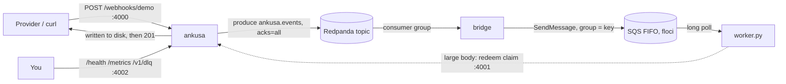

# Quickstart

Run Ankusa, a broker, and a worker you own, send webhooks, then stop the
worker and the broker and watch what happens to the hooks already
acknowledged. You need Docker with Compose v2 and `curl`; nothing else.

## 1. Start Ankusa, a broker, and a worker

```sh
git clone https://github.com/jamescarr/ankusa
cd ankusa/examples/quickstart
docker compose up --build -d --wait
```



[`ankusa.yml`](https://github.com/jamescarr/ankusa/blob/main/examples/quickstart/ankusa.yml)
declares one source (`demo`) with one Kafka sink producing to the
`ankusa.events` topic, which
[`docker-compose.yml`](https://github.com/jamescarr/ankusa/blob/main/examples/quickstart/docker-compose.yml)
creates before Ankusa starts: the sink never creates a topic. A Redpanda
Connect bridge
([`bridge/bridge.yaml`](https://github.com/jamescarr/ankusa/blob/main/examples/quickstart/bridge/bridge.yaml))
carries each record into an SQS FIFO queue in floci, with the record key
(tenant and source) as the FIFO group, so a source's hooks reach the worker in
the order Ankusa produced them. That is not the order they arrived in: dispatch
runs attempts concurrently and a retried hook goes out after later ones. For
per-key order, set `ordered: true` and an `ordering_key` on the sink
([Ordering lanes](delivery.md#ordering-lanes)).
[`worker.py`](https://github.com/jamescarr/ankusa/blob/main/examples/quickstart/worker.py)
polls that queue with `boto3`, decodes each message with the `ankusa` Python
SDK, and prints what it receives.

## 2. Send a webhook

```sh
curl -XPOST localhost:4000/webhooks/demo -H 'content-type: application/json' -d '{"id":"evt_1","type":"invoice.paid"}'
# => {"id":"01a0...","status":"accepted"}

sleep 2 && docker compose logs worker
# received id=01a0... source=demo via=inline bytes=36 body={"id":"evt_1","type":"invoice.paid"}
```

A body over the sink's `inline_max_bytes` (8 KiB here) is checked in on the
node instead, and the message carries a claim ref the worker redeems from the
claim-check gateway, so the broker never carries a large payload:

```sh
printf '{"id":"evt_2","pad":"%s"}' "$(head -c 20000 /dev/zero | tr '\0' x)" |
  curl -XPOST localhost:4000/webhooks/demo -H 'content-type: application/json' --data-binary @-
sleep 2 && docker compose logs worker | grep evt_2
# received id=01a0... source=demo via=claim bytes=20023 body={"id":"evt_2","pad":"xxxx...
```

The `201` returns only after the hook is durably accepted — here, after the
node's store has fsynced it. That is
[the core invariant](architecture.md#the-core-invariant), not a formality:
neither the broker nor the worker is on the request path, and a hook the
provider was told about cannot be lost to a slow or dead worker.

## 3. A provider retry is a new hook

Without a source [`dedupe:`](configuration.md#sources) setting, ingest does not
collapse repeats. Send the identical request again and it is a new hook with a
new `id`, stored and delivered a second time:

```sh
curl -XPOST localhost:4000/webhooks/demo -H 'content-type: application/json' -d '{"id":"evt_1","type":"invoice.paid"}'
# => {"id":"01b1...","status":"accepted"}
```

That is at-least-once on purpose: the provider's retry contract is honored
without an ingest-side dedup table, and your worker is the idempotent receiver
(see [Replay is safe](#replay-is-safe) below, and
[`delivery.md`](delivery.md#idempotent-receivers)). Set `dedupe:` on a source
whose provider sends a stable event id, and the second request answers `201
{"status":"accepted","id":"01a0...","duplicate":true}` instead.

## 4. When your worker goes down

```sh
docker compose stop worker
curl -XPOST localhost:4000/webhooks/demo -H 'content-type: application/json' -d '{"id":"evt_3"}'
curl -s localhost:4002/v1/dlq
# => {"total":0,"entries":[],"next_cursor":null}
docker compose start worker
until docker compose logs worker | grep evt_3; do sleep 2; done
```

Nothing was retried and nothing dead-lettered. The hook was produced to the
topic and carried into the FIFO queue while the worker was away, and the queue
held it until the worker came back: a worker outage is the queue's to absorb.
It can take about 30 s to show up: the long poll the stopped worker left open
may already have received the message, and SQS hides a received message for
the queue's visibility timeout (30 s here) whether or not its receiver lives to
process it, then hands it to the next poll.

## 5. When the broker goes down

### Dead-lettered, then replayed

```sh
docker compose stop redpanda
curl -XPOST localhost:4000/webhooks/demo -H 'content-type: application/json' -d '{"id":"evt_4"}'
# => {"id":"01a0...","status":"accepted"}
until curl -s localhost:4002/v1/dlq | grep -q '"total":1'; do sleep 2; done
curl -s localhost:4002/v1/dlq
# => {"total":1,"entries":[{"id":"01a0...",...,"source_id":"demo",...}],"next_cursor":null}
docker compose up -d --wait redpanda    # back, and healthy
curl -XPOST localhost:4002/v1/replays -d '{"kind":"dlq","source_id":"demo","rate":100}'
# => 202 {"id":"01a0...","kind":"dlq","state":"running","filter":{"source_id":"demo"},...}
until docker compose logs worker | grep evt_4; do sleep 2; done
```

The provider still got its `201` with the broker gone, because the ack never
depended on it: Ankusa held the hook, retried the produce until the retry
budget ran out, and dead-lettered it. `ankusa.yml` caps retries at 6 attempts
(roughly 8–15 s, jitter included) and turns off the sink's circuit breaker so
this drill takes seconds; the default retries for 24 hours
(`dispatch.retry.max_elapsed_ms`), backing off to 5 min, and after 5 failures
in a row parks the sink's hooks behind an open breaker without spending
attempts ([A slow or dead sink](delivery.md#a-slow-or-dead-sink)). With the
defaults, a broker outage this short is simply retried and never dead-letters.

### Replay is safe

A replay is a durable job, not a one-shot flip: it drips dead rows back into
the delivery queue at `rate` items per second, and only while dispatch has
spare capacity (the oldest-due lag stays under `max_lag_ms`, 2 s by default),
so it cannot flood a recovering sink or starve live traffic. Each replayed
delivery keeps the hook's original id and carries the job's `replay_id`. Watch
it and stop it at any time:

```sh
curl -s localhost:4002/v1/replays/<job-id>
# => {"state":"done","moved":1,"delivered":1,...}
curl -XPATCH localhost:4002/v1/replays/<job-id> -d '{"state":"cancelled"}'
```

Redelivery is still at-least-once, so the receiver stays idempotent: a hook
that reached the sink before it failed is delivered again as a message with
the same `id` and the same `idempotency_key`, and the worker dedupes on the
latter — here with an in-memory set, which a real worker replaces with a
unique key in its database. In this drill the broker was down for every
attempt, so replay delivers `evt_4` once and never again.

## 6. Inspect the node

```sh
curl localhost:4002/health
# => {"status":"ok","instance":"default","version":"…","roles":["claim_check","dispatch","edge","storage"]}
curl localhost:4002/ready
# => {"status":"ready","instance":"default","store":"ok"}
curl -s localhost:4002/metrics | grep ankusa_ingest_requests_total
curl localhost:4002/v1/config      # the effective config, secrets redacted
curl localhost:4002/v1/quarantine  # hooks held after a failed verification
# fixed the secret? release the held hooks that now verify:
curl -XPOST localhost:4002/v1/replays -d '{"kind":"quarantine"}'
```

`/health` is liveness; `/ready` answers whether this node can take a hook right
now (the store takes a synced write), which is the probe a load balancer
should use. Port 4002 is the operator API: never publish it publicly. The
compose file binds it to `127.0.0.1` on the host, and `ankusa.yml` sets
`admin.ip: 0.0.0.0` with `auth.allow_insecure: true` so that published port
reaches the API inside the container; this demo is open to anything that can
reach it. A real deployment sets `admin.auth` (a token, your OIDC provider, or
client certificates; see
[Control-plane authentication](configuration.md#control-plane-authentication)).

## 7. Point a real provider at it

Add the provider as a second source under `sources:` in `ankusa.yml`:

```yaml
  stripe:
    verify: {type: stripe, secret: "${STRIPE_WHSEC}", tolerance_seconds: 300}
    on_verify_failure: quarantine
    sinks:
      - type: kafka
        brokers: [redpanda:9092]
        topic: ankusa.events     # the same topic; keyed by tenant/source, so its own FIFO group
        inline_max_bytes: 8192
```

Pass the secret in as an environment variable by adding `environment:
[STRIPE_WHSEC]` to the `ankusa` service, then check the file before starting:

```sh
STRIPE_WHSEC=whsec_... docker compose run --rm ankusa check-config
# config OK: roles=[:edge, :dispatch, :storage, :claim_check] sources=demo,stripe ...
STRIPE_WHSEC=whsec_... docker compose up -d
```

A bad file exits `78` and names the field. Expose ingest with a tunnel, then set
the provider's endpoint to `<tunnel>/webhooks/stripe`:

```sh
ngrok http 4000     # or cloudflared / tailscale funnel
```

GitHub and Standard Webhooks sources are the same shape with a different
`verify.type`: [`configuration.md`](configuration.md#sources).

## Ingest responses

| Status | Meaning |
| --- | --- |
| `201` | Accepted, durably so. A repeat on a source with `dedupe:` answers `201` with the original `id` and `"duplicate": true`, and stores nothing new. |
| `202` | Quarantined after a failed verification (`on_verify_failure: quarantine`). It is held, not accepted for delivery. |
| `400` | The body could not be read, or a header holds a byte outside visible ASCII, space and tab (`invalid_header`; no sink could carry it, so retrying is pointless). |
| `401` | Verification failed under `on_verify_failure: reject`. |
| `404` | Unknown source, or a source owned by another tenant. |
| `409` | `dedupe_pending`: another node is committing the same event key (fleet-scoped dedupe). Retry. |
| `413` | Body over `max_body_bytes`. |
| `429` | Over a rate limit, nothing stored: the tenant's (`rate_limited`) or, for a hook that would be quarantined, its source's quarantine bucket (`quarantine_rate_limited`). Retry after `Retry-After`. |
| `503` | No durable destination right now: overload, the store could not take the commit (`store_unavailable`), the intake log could not confirm (`intake_unavailable`, `intake_pending`), or a sink refused under `wal.type: none`. Also a full quarantine pen (`quarantine_full`, `Retry-After: 60`). Retry later. |

`201 accepted` is the only committed response, and it comes back only after a
durable accept: the store's synced commit (`wal.type: disk`, the default), the
store and the Kafka intake log (`wal.type: dual`), or every sink's confirm
(`wal.type: none`). There is no `200`. Without a source `dedupe:` setting,
every accepted POST is a new hook with a new `id`, and a provider retry after a
lost ack is stored and delivered again.

The catch URL is `/webhooks/:source_id` by default; a tenant-in-the-URL scheme
is one config line away, see [`multi-tenancy.md`](multi-tenancy.md).

## Clean up

```sh
docker compose down -v
```

## Where next

- Every YAML key: [`configuration.md`](configuration.md)
- Guarantees and failure modes: [`architecture.md`](architecture.md)
- Roles, fleets, the container: [`deployment.md`](deployment.md)
- Sinks, retries, the dead-letter queue, quarantine: [`delivery.md`](delivery.md)
- Oban, Celery, and queue handoff: [`integrations.md`](integrations.md)
- All the examples: [examples/README.md](https://github.com/jamescarr/ankusa/blob/main/examples/README.md)
- Embedding in an Elixir app instead: [`elixir.md`](elixir.md)
