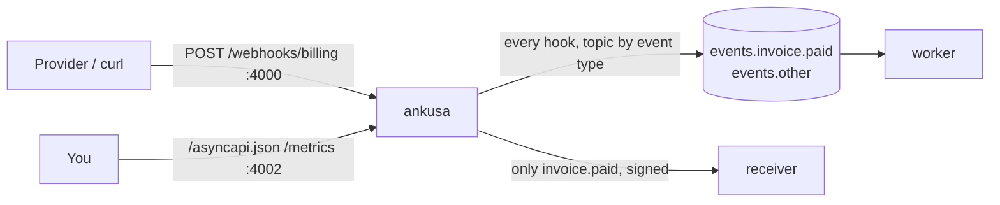

# Example: route by what the hook says it is

One Ankusa source, no code: it reads an **event type** from each hook's JSON body,
names a Kafka **topic** by it, and sends only one event type to an **HTTP**
receiver. The three keys are `event_type:`, a sink's `filter:`, and a
`{{ var }}` template; the reference is
[Routing by content](../../docs/delivery.md#routing-by-content).



## What's here

| File | What it is |
| --- | --- |
| `docker-compose.yml` | Redpanda (with its two topics created up front), Ankusa built from this checkout, the worker and the receiver |
| `ankusa.yml` | Two sources: `billing` (a Kafka sink and a filtered HTTP sink) and `invoices` (only the filtered HTTP sink) |
| `worker/` | TypeScript: consumes `events.invoice.paid` and `events.other`, decodes each record with the `ankusa` SDK and prints its `event_type` |
| `receiver/` | TypeScript: a plain `node:http` server that verifies each delivery's signature with `receiveDelivery` and prints it |
| `run.sh` | Posts three hooks and exits non-zero unless each one landed where it should |

## The config

```yaml
sources:
  billing:
    verify: {type: none}
    event_type: {json: type}                        # read once, at ingest
    sinks:
      - type: kafka
        brokers: [redpanda:9092]
        topic: "events.{{ event_type ?? other }}"   # named by it, at delivery
      - type: http
        url: http://receiver:3000/invoices
        filter: {event_type: [invoice.paid]}        # only these, chosen at ingest
        secret: ${SINK_WHSEC}
        allow_unsigned: false
```

The order matters: the event type is read first, the filters then choose which
sinks get a delivery row, and the template is rendered when a row is delivered.
A Kafka sink never creates a topic, so `docker-compose.yml` creates both topics
the template can render.

## Run it

```sh
docker compose up --build -d --wait
./run.sh
# POST /webhooks/billing {"type":"invoice.paid","ref":"paid-…"} -> 201 {"id":"…","status":"accepted"}
# POST /webhooks/billing {"event":"customer.created","ref":"cust-…"} -> 201 {"id":"…","status":"accepted"}
# POST /webhooks/invoices {"event":"customer.created","ref":"cust-…"} -> 201 {"id":"…","status":"accepted","filtered":true}
# OK: invoice.paid on events.invoice.paid and at receiver; customer.created on events.other only
```

(The first build compiles the Ankusa release from this checkout, so it takes a
few minutes.) If 4000 or 4002 is taken on your machine, set `INGEST_PORT` and
`ADMIN_PORT` for both commands: `INGEST_PORT=14000 ADMIN_PORT=14002 docker compose up …`.

What the three hooks show:

1. `{"type":"invoice.paid"}` reads as event type `invoice.paid`. The Kafka sink
   renders `events.invoice.paid`, and the HTTP sink's filter selects it:

   ```sh
   docker compose logs --no-log-prefix worker receiver
   # received topic=events.invoice.paid id=01a1… event_type=invoice.paid body={"type":"invoice.paid",…}
   # received id=01a1… source=billing event_type=invoice.paid verified=true body={"type":"invoice.paid",…}
   ```

   The receiver got the type as the `x-ankusa-event-type` header, and the worker
   as the message's `event_type`.

2. `{"event":"customer.created"}` has no `type` key, so this source reads **no**
   event type from it (`event_type` is `null`, counted in
   `ankusa_ingest_event_type_missing_total`). The template takes its fallback,
   `events.other`, and the filter does not match, so the receiver never sees it:

   ```
   received topic=events.other id=01a1… event_type=null body={"event":"customer.created",…}
   ```

   (A hook `{"type":"customer.created"}` would be read as `customer.created` and go
   to `events.customer.created`: a topic you must create first. Without a
   `?? fallback`, a hook with no event type is a permanent dead letter,
   `{:template_missing, "event_type"}`.)

3. The `invoices` source has only the filtered HTTP sink, so a hook that is not an
   `invoice.paid` is selected by **no** sink. Ankusa answers `201` with
   `"filtered": true` and stores nothing: a hook with no delivery row would never
   be reclaimed, and nobody asked for it.

   ```sh
   curl -si -XPOST localhost:4000/webhooks/invoices -H 'content-type: application/json' \
     -d '{"event":"customer.created"}'
   # HTTP/1.1 201 Created
   # {"id":"01a1…","status":"accepted","filtered":true}
   ```

   `curl -s localhost:4002/metrics | grep filtered` counts each unselected sink:
   `ankusa_dispatch_filtered_total{sink="Ankusa.Sink.Http",…}`.

## The AsyncAPI document

A templated address is dynamic, so `GET /asyncapi.json` lists the Kafka channel
without an address instead of advertising a topic that is wrong for most hooks
([`asyncapi.md`](../../docs/asyncapi.md)). The same channel carries the message
schema, including `event_type`:

```sh
curl -s localhost:4002/asyncapi.json | jq '.channels["kafka-redpanda_9092-billing-dynamic"] | {title, description}'
# {
#   "title": "Dynamic address (billing)",
#   "description": "Hooks from: billing. The address is computed per hook (by a configured function or a template) and cannot be advertised."
# }
```

The HTTP sinks are not in the document: it describes the message a queue
carries, not the raw body an HTTP sink sends.

## Tear down

```sh
docker compose down -v   # the -v drops the data volume too
```
