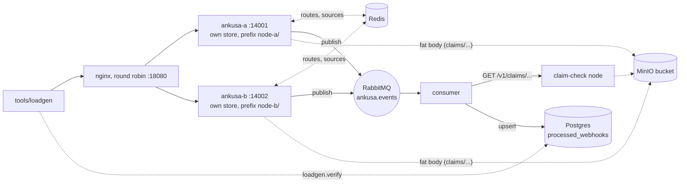

# Example: fleet end to end

The automated multi-node proof. Run in CI every night
([`.github/workflows/e2e.yml`](../../.github/workflows/e2e.yml)), on demand and
on every release tag: a load balancer in front of two Ankusa nodes, a shared
bucket and claim-check gateway, a consumer, and a check that every hook the
fleet acknowledged was processed, with a node killed in the middle.



## What each piece is doing

- `ankusa-a`, `ankusa-b`: the published image's code (built from this checkout),
  every role, each with its **own RocksDB store**, so a hook acknowledged by one
  node is on that node's disk until it is dispatched. They share one bucket
  through distinct `storage.key_prefix`es (`node-a/`, `node-b/`), and share
  route definitions and API-managed sources through Redis (`routes.store` and
  `source_store`, both `type: redis`, from `ankusa_redis`). One
  [`ankusa.yml`](ankusa.yml) configures them all.
- `claim-check`: the same image with `ANKUSA_ROLES=claim_check`. Claims are
  never prefixed, so it serves the fat bodies of both nodes. It is the only
  reader of the bucket on the consumer's side of the fence.
- `nginx`: round robin over both nodes, re-resolving their names, so a node
  that was killed and restarted rejoins ([`nginx.conf`](nginx.conf)).
- `consumer/`: the [`rabbitmq-consumer`](../rabbitmq-consumer/) worker, with the
  print replaced by an upsert into `processed_webhooks` (`schema.sql`: the table
  `mix loadgen.verify` reads, keyed by the message's `idempotency_key`). It owns
  its queue and holds no storage credentials: bodies over 8 KiB are redeemed at
  the gateway.

## Run it

```sh
examples/fleet-e2e/run.sh
# ...
# verify: missing=0 sha_mismatches=0 extra_deliveries=<n> claim_redeemed_cross_node=true duplicate_hooks=0
```

Needs `docker` with Compose, `mix`, `curl` and `jq`. It builds the server image
(`ankusa-fleet-e2e:local`, slow the first time: RocksDB compiles), brings the
stack up, and runs four phases. Only `18080` (the load balancer), `14001` and
`14002` (the nodes) and `15433` (Postgres) are published, on loopback.

| Phase | What it does | What it asserts |
| --- | --- | --- |
| steady | `RATE`/s for `DURATION` s through the load balancer | `loadgen.verify`: every acked id processed, sha256 equal |
| fat hooks | a 20 KB body POSTed to each node directly | each arrives with `via = claim:<id>`, redeemed through the gateway, sha256 equal |
| chaos | the same load while `ankusa-a` is killed (+10 s) and started (+20 s), event *E* is delivered to node b and then **retried on node a**, and the consumer is killed (+30 s) | `loadgen.verify` again; both retry POSTs answer `201`, the second with the first's hook id; *E* is one row with one hook id |
| burst | `CONCURRENCY` closed-loop workers for `BURST_SECONDS` | `loadgen.verify` |

Before the phases it also asserts that a path nobody defined is a `404` on both
nodes and through the load balancer, which only holds if they enforce the same
Redis-held routes.

### `extra_deliveries` and `duplicate_hooks`

`extra_deliveries` is the number of times the consumer received a hook beyond the
first for its idempotency key, summed over the phases and the retry. It has two
components, and only one of them is Ankusa's to remove:

* **duplicate hooks**: the same provider event stored as two hooks with two ids.
  With `dedupe.scope: fleet` (this example's `ankusa.yml`) *E* retried on the other
  node is answered with the first hook's id before anything is committed, so this
  is 0. The run reports it separately as `duplicate_hooks` (distinct hook ids per
  idempotency key, minus one, read from the consumer table's `hook_ids`) and
  **fails** when it is not 0.
* **broker redeliveries**: RabbitMQ delivering a hook again after the consumer
  was killed mid-handling. That is the at-least-once contract, ingest cannot
  prevent it, and the chaos phase deliberately provokes it. It stays in
  `extra_deliveries`, which is reported and not asserted to be zero.

So `extra_deliveries = duplicate_hooks + redeliveries`, and `TEN-6` (fleet-scoped
dedupe, in [`ANKUSA_HARDENING_PLAN.md`](../../ANKUSA_HARDENING_PLAN.md)) zeroes the
first term.

### `--wal dual --kill-node`: losing the host, not the process


```sh
examples/fleet-e2e/run.sh --wal dual --kill-node   # missing=0
examples/fleet-e2e/run.sh --wal disk --kill-node   # loses the hooks acked since the last backup, and says so
```

`--wal dual` runs the whole fleet under `wal.type: dual`
([ADR 0002](../../docs/adr/0002-dual-commit-intake-log.md)): a three-broker KRaft
Kafka (the `dual` compose profile, topic `ankusa.intake.fleet` with replication
factor 3 and `min.insync.replicas=2`) is the intake log, every hook is confirmed
in it before its `201`, and each node has an `intake.node_id` (`ankusa-a`,
`ankusa-b`: `ANKUSA_INTAKE_NODE_ID`) that a replacement starts with.
`--kill-node` turns the backup on (every 15 s, a primary and a secondary bucket)
and, after the chaos phase, loses the *host*:

| Phase | What it does | What it asserts |
| --- | --- | --- |
| host loss | `RATE` (1 000) per second; at +5 s RabbitMQ is **paused** so acked hooks wait undelivered on their node; at +12 s `ankusa-a` is killed **and its volume deleted**; at +14 s a replacement starts with the same node id on an empty volume; at +20 s RabbitMQ resumes | `dual`: the replacement restores the backup and replays the intake log, and every `201` id reaches the consumer (`missing=0`, `duplicate_hooks=0`). `disk`: only the backup comes back, so the hooks acked since it (still undelivered when the host died) are gone, and the run **fails unless it sees that loss** |
| brokers down | (`dual`) the three brokers stop; 16 requests go straight to the nodes | every one is `503 intake_unavailable` with `Retry-After`, none is acked, `/ready` is 503; after the brokers return both nodes answer `201` |
| secondary only | (`dual`) the same load; the primary backup is deleted, the host lost again | the store is restored from the **secondary** bucket and brought forward by the image's `recover` command (it must apply hooks from the log), then every `201` id reaches the consumer |

Pausing RabbitMQ is what makes the loss real. Without it the dispatcher delivers
a hook within milliseconds of the ack, so a node killed a moment later has
nothing undelivered to lose and `disk` would look as safe as `dual`.

`extra_deliveries` after a host loss includes the hooks the lost node had delivered
and its replacement delivers again from the backup and the log (same hook id, same
`idempotency_key`); the consumer dedupes on the key and `duplicate_hooks` stays 0.

### Knobs

| Variable | Default | |
| --- | --- | --- |
| `RATE` | `200` (`1000` with `--kill-node`) | paced requests per second (steady, chaos, host loss) |
| `DURATION` | `45` | seconds per paced phase; at least 40, the chaos timeline runs to +35 s |
| `BURST_SECONDS`, `CONCURRENCY` | `10`, `32` | the closed-loop burst |
| `BUILD_ANKUSA` | `1` | `0` skips `docker build` and uses `ANKUSA_IMAGE` |
| `ANKUSA_IMAGE` | `ankusa-fleet-e2e:local` | the server image the nodes run |
| `KEEP` | `0` | `1` leaves the stack up |
| `OUT_DIR` | `examples/fleet-e2e/.e2e-out` | loadgen CSVs and JSON reports |
| `WAL`, `BACKUP` | set by `--wal`, `--kill-node` | what the compose file passes the nodes (`ANKUSA_WAL_TYPE`, `ANKUSA_BACKUP_ENABLED`) |

With `KEEP=1`, send hooks by hand with
`curl -XPOST localhost:18080/webhooks/demo -d '{"id":"evt_1"}'` and watch the
rows with
`docker compose -f examples/fleet-e2e/docker-compose.yml exec postgres psql -U ankusa consumer -c 'select idempotency_key, deliveries, via from processed_webhooks'`.
Tear down with `docker compose -f examples/fleet-e2e/docker-compose.yml down -v`.
