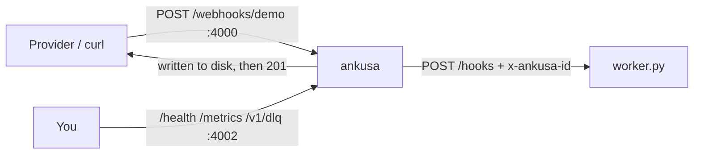

# Example: Ankusa → an HTTP worker you own

The published Ankusa image receives webhooks and POSTs each one to a
small [FastAPI](https://fastapi.tiangolo.com/) worker: no Elixir, no broker,
no object store. The worker depends on the `ankusa` Python SDK
([`packages/sdk-python`](../../packages/sdk-python)) for header parsing,
managed with [`uv`](https://docs.astral.sh/uv/).



## What's here

| File | What it is |
| --- | --- |
| `docker-compose.yml` | Ankusa on 4000 (ingest) and 127.0.0.1:4002 (admin), plus the worker |
| `ankusa.yml` | One open `demo` source whose single HTTP sink points at the worker, with retries shortened so the drills are quick |
| `pyproject.toml` / `uv.lock` | The worker's `uv` project; `ankusa` resolves to [`../../packages/sdk-python`](../../packages/sdk-python) as a local path dependency |
| `Dockerfile` | Builds the worker with `uv sync --locked`; built from the **repo root** so it can see `packages/sdk-python` (see the comment at its top) |
| `worker.py` | FastAPI app: reads the body, parses headers via `ankusa.parse_headers`, dedupes on `ankusa.idempotency_key` (the `x-ankusa-idempotency-key` header), prints |

## Run it

```sh
docker compose up --build -d --wait

curl -XPOST localhost:4000/webhooks/demo -H 'content-type: application/json' -d '{"id":"evt_1","type":"invoice.paid"}'

sleep 1 && docker compose logs worker
# received id=01a0... source=demo bytes=36 body={"id":"evt_1","type":"invoice.paid"}
```

Tear down (the `-v` drops the data volume too):

```sh
docker compose down -v
```

Editing `worker.py` needs a rebuild (`docker compose up --build -d --wait`):
it's baked into the image, not bind-mounted, since the image now also needs
`packages/sdk-python` present at build time.

Developing the worker outside Docker: `uv sync && uv run python worker.py`
from this directory.

## Write your own worker

- Ankusa POSTs the hook's **raw body verbatim**, with the provider's `content-type`.
- Identity is in headers: `x-ankusa-id`, `x-ankusa-source`,
  `x-ankusa-idempotency-key`, and `x-ankusa-tenant` when the source has one.
- **`2xx` means delivered.** Anything else, a timeout (default 5s), or a redirect
  is retried per `dispatch.retry`, then dead-lettered.
- **Dedupe on `x-ankusa-idempotency-key`**: delivery is at-least-once, so the same hook can
  arrive twice after a retry.
- Point `url:` at your service. Compose service names resolve; outside compose,
  use a host the container can reach.

## When the worker is down

### Short outage: retried until it comes back

```sh
docker compose stop worker
curl -XPOST localhost:4000/webhooks/demo -H 'content-type: application/json' -d '{"id":"evt_2"}'
docker compose start worker
sleep 10 && docker compose logs worker | grep evt_2
```

The provider still got its `201`: Ankusa holds the hook and retries delivery
until the worker answers or the retry budget runs out.

### Long outage: dead-lettered, then replayed

```sh
docker compose stop worker
curl -XPOST localhost:4000/webhooks/demo -H 'content-type: application/json' -d '{"id":"evt_3"}'
sleep 20
curl -s localhost:4002/v1/dlq
# => {"total":1,"entries":[{"id":"01a0...","source_id":"demo",...}]}
docker compose start worker
curl -XPOST localhost:4002/v1/replays -d '{"kind":"dlq","source_id":"demo","rate":100}'
# => 202 {"id":"01a0...","kind":"dlq","state":"running","filter":{"source_id":"demo"},...}
sleep 1 && docker compose logs worker | grep evt_3
```

`ankusa.yml` caps retries at 6 attempts (roughly 8–15 s, jitter included) so
this drill takes seconds; the default retries for 24 hours
(`dispatch.retry.max_elapsed_ms`), backing off to 5 min.

### Replay is safe

A replay is a durable job, not a one-shot flip: it drips dead rows back into
the delivery queue at `rate` items per second, and only while dispatch has
spare capacity (the oldest-due lag stays under `max_lag_ms`, 2 s by default),
so it cannot flood a recovering sink or starve live traffic. Each replayed
delivery keeps the hook's original id and carries the job's `replay_id`. Watch
it and stop it at any time:

```sh
curl -s localhost:4002/v1/replays/<job-id>
# => {"state":"done","moved":1,"delivered":1,...}
curl -XPATCH localhost:4002/v1/replays/<job-id> -d '{"state":"cancelled"}'
```

Redelivery is still at-least-once, so the receiver stays idempotent: a hook
that reached the sink before it failed is delivered again with the same
`x-ankusa-id` and the same `x-ankusa-idempotency-key`, and the worker dedupes
on the latter — here with an in-memory set, which a real worker replaces with a
unique key in its database. In this drill the worker was down for every
attempt, so replay delivers `evt_3` once and never again.
