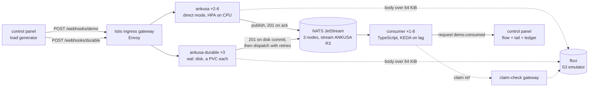

# Example: an autoscaling ankusa fleet and a durable one → NATS JetStream → an autoscaling consumer, on `kind` with Helm and Istio

A local Kubernetes (`kind`) cluster, installed with Helm, that you can push
around from a browser. An Istio ingress gateway (Envoy) load-balances
`POST /webhooks/demo` across a fleet of stateless ankusa ingest pods that
scales on CPU, and `POST /webhooks/durable` across a second, durable fleet
of three pods that store every hook on their own disk before answering. Both
publish to a three-node NATS JetStream cluster (an R3 stream), and a
TypeScript consumer fleet that scales on JetStream lag pulls from it. A
Phoenix LiveView control panel, running in the same cluster, fires synthetic
webhooks at either fleet, draws the flow live, tails what the consumers
processed, and breaks things on request, once or on a timer.



**What each piece proves:**

- **Direct mode (`wal.type: none`) scales out as a plain Deployment.** The
  ankusa pods hold no hook store: each one verifies the hook, publishes it to
  JetStream inside the request, and answers `201` only on JetStream's publish
  ack (any failure is a `503` with `Retry-After`). They share nothing, so an
  HPA on container CPU adds and removes them freely, and a pod killed
  mid-request costs the provider one retry, not a hook. See
  [`docs/architecture.md`](../../docs/architecture.md).
- **Durable mode (`wal.type: disk`) turns a sink outage into a backlog.** The
  `ankusa-durable` StatefulSet's pods each commit a hook to their own RocksDB
  store (a 1 GiB PVC) and answer `201` once it is on disk; dispatch then
  publishes it to JetStream (subject `ankusa.durable`, inside the same
  stream) with retries, a circuit breaker per sink and a DLQ, replayable from
  the admin API. NATS being down is not the provider's problem: ingest keeps
  answering `201` and the store holds the hooks until NATS is back. A killed
  pod comes back under the same name on the same volume, with its backlog.
  Each pod has its own store, so dedupe on the event id is per pod, and the
  fleet has no autoscaler: scaling a pod away would strand what it holds. See
  [`docs/delivery.md`](../../docs/delivery.md).
- **The consumer owns the topology.** The ankusa NATS sink never creates a
  stream: the consumer creates the `ANKUSA` stream (R3, subjects `ankusa.>`)
  and its durable pull consumer `worker` on boot, and every replica shares
  that one consumer. The stream is a work queue (a hook leaves it when acked)
  that refuses new publishes once 640 MiB are queued (`discard: new`), so a
  backlog the consumers cannot clear pushes back on the providers with `503`s
  instead of silently deleting hooks. The consumer dedupes on
  `idempotencyKey`, `ack`s what it processed, and `nak`s what a retry can fix
  (retried without limit, backing off to 10 s). What can never succeed (a body
  that is not a message, a claim that is gone) is copied, with the reason in a
  header, to a dead-letter stream (`ANKUSA_DLQ`, subject `dlq.ankusa`) and then
  `term`ed; the panel shows a *dead-lettered* count when it is not zero. KEDA
  reads the consumer's lag from NATS's monitoring
  endpoint and scales the Deployment.
- **Large bodies take the claim-check path.** A body over `inline_max_bytes`
  (64 KiB here) is checked in to an S3 bucket (floci, the repo's emulator) by
  the ingest pod before it publishes; the message carries a claim ref, which
  the consumer redeems through the claim-check gateway. The consumer holds no
  object-store credentials. See [`docs/claim-check.md`](../../docs/claim-check.md).
- **The mesh is the chaos surface.** Every pod has an Envoy sidecar, so sidecar
  to sidecar traffic is mTLS and carries the caller's ServiceAccount. The panel
  cuts a connection with an Istio `AuthorizationPolicy` `DENY` on that
  principal, and breaks the gateway with a `fault` on the `VirtualService`.

## Prerequisites

- `docker` with at least **8 GB** of memory. A first run pulls and builds
  roughly 6 GB of images (Istio, NATS, KEDA, floci, and the three apps).
- `mise install`, which brings the pinned `kind`, `kubectl` and `helm`
  (`.mise.toml`).
- Free port `8080` on the host.

## Run it

```sh
examples/jetstream-k8s/run.sh          # same as: run.sh up. Safe to re-run.
```

It creates the kind cluster, builds and loads the three images, installs
metrics-server, Istio (base, istiod, the ingress gateway), KEDA and NATS with
Helm, then installs this example's own chart
([`chart/`](chart/)). It ends when the gateway answers a webhook with `201` and
serves the panel:

|URL|What|
|---|---|
|<http://localhost:8080/>|the control panel|
|`POST http://localhost:8080/webhooks/demo`|ingest, through Envoy, to the direct fleet|
|`POST http://localhost:8080/webhooks/durable`|ingest, through Envoy, to the durable fleet|

`up` never tears anything down, so re-running it rebuilds the images and rolls
the deployments. `examples/jetstream-k8s/run.sh down` deletes the cluster.

### Env knobs

| Var | Default | Meaning |
| --- | --- | --- |
| `CLUSTER` | `ankusa-jetstream` | kind cluster name |
| `NS` | `ankusa-jetstream` | namespace of the demo (labelled for sidecar injection) |
| `ANKUSA_IMAGE` | `jamescarr/ankusa:dev` | the ingest / claim-check image |
| `BUILD_ANKUSA` | `1` | `0` skips `mise run docker:build`; pair with a published `ANKUSA_IMAGE`, e.g. `BUILD_ANKUSA=0 ANKUSA_IMAGE=jamescarr/ankusa:edge` |
| `ISTIO_VERSION` | `1.30.6` | Istio chart version |
| `KEDA_VERSION` | `2.21.0` | KEDA chart version |
| `NATS_CHART_VERSION` | `2.15.1` | `nats/nats` chart version |
| `METRICS_SERVER_CHART_VERSION` | `3.14.0` | metrics-server chart version |

Watch the autoscalers while you play:

```sh
kubectl -n ankusa-jetstream get pods,pvc,hpa,scaledobject -w
```

## The control panel

- **Sender.** *Direct* / *Durable* picks the fleet it posts to
  (`/webhooks/demo` or `/webhooks/durable`); a request already retrying keeps
  its target. Start/Stop runs a steady stream at *rate* req/s (0-500). *Size
  min* and *size max* set each body's size, drawn uniformly between them, on a
  log scale from 64 B to 4 MiB (the slider shows the bytes; 64 KiB is position
  62.5, so *size min* ≥ 63 sends only claimed bodies). *Burst volume* sets how
  many extra hooks *Fire burst* queues, whether or not the steady stream is
  running. Each request goes to the ingress gateway, and a `503`, `429` or
  transport error is retried up to three times a second apart with the *same*
  event id (`x-demo-event-id`): that is what a
  webhook provider does. Requests the in-flight cap (256) holds back are
  deferred, not dropped.
- **Flow.** sender → Envoy → ankusa pods (the direct ones, then
  `ankusa-durable-0..2`) → JetStream → consumer pods, with floci and the
  claim-check gateway as the side path. Edge thickness and dash speed follow
  the rate; a pod's border is green when ready, amber when not, red while
  terminating; `✕` kills that pod. A durable pod shows its ingest rate and
  queue (`q`), its edge to JetStream follows what it *delivers*, and while its
  NATS breaker is open it reads `breaker open` with an amber border. The chips
  under the columns show the HPA's and KEDA's current/desired replicas and the
  CPU / lag they act on.
- **Totals.** *sent*, *accepted* (answered `201`), *consumed (unique)*,
  *duplicates (ingest / consumer)* (retries a durable pod answered
  `"duplicate": true`, which direct mode never does / hooks a consumer saw a
  second time), *failed* (gave up after retries), *retried*, *in flight* and
  the mean *ingest latency*. The **zero loss** badge is
  `accepted − consumed (unique)`: it turns green when it is 0, the sender has
  stopped, JetStream is empty and the durable pods have nothing queued. Rows in
  the durable fleet's DLQ are accepted but not consumed, and the badge says so
  (`N not consumed · N in ankusa DLQ (replay)`). "Unique" counts a hook once by
  idempotency key across all consumer pods, so a hook redelivered to another pod
  is a duplicate, not a second hook.
- **Durable store.** One row per durable pod: hooks committed (*in/s*) and
  delivered (*out/s*) a second, *pend* (due now or being delivered), *sched*
  (due later: backing off, or parked while the breaker is open), *dead* (out of
  attempts: the DLQ), *brk* (the NATS sink's breaker) and the store's size on
  disk. *Replay DLQ* starts a DLQ replay on every pod
  (`POST :4002/v1/replays {"kind":"dlq","source_id":"durable"}`; each pod
  replays its own store); *Kill all durable pods* SIGKILLs the three at once.
- **Chaos.** One-shot levers (kill a pod, cut a connection, a gateway fault,
  which hits both ingest routes) and two timed ones: *Flap a connection* denies
  a lever for *down* seconds, allows it for *up* seconds, and repeats until
  *Stop*, which leaves it allowed; *Rolling kills* SIGKILLs a random pod of a
  group now and then every *every* seconds.
- **Consumed.** The last 30 hooks the consumers processed: time (UTC), hook id,
  pod, size, `inline` or `claim`, ingest-to-consumed latency, and `dup` when a
  pod had already seen it.

Only the generator's own hooks are counted in the totals; a hand-made `curl`
is consumed and listed, but not counted. The sender's snapshot trails the
consumers' by up to half a second, so while it runs the badge reads "in
transit" rather than a transient surplus.

**The panel is the consumers' ledger.** A consumer announces each hook it has
processed with a NATS *request* to `demo.consumed` and acks the hook only when
the panel replies. A plain publish (or a `flush`, which only proves the local
sidecar took the bytes) can vanish when a connection is cut underneath it:
applying or removing an `AuthorizationPolicy` on the NATS pods makes Envoy
close the connections it carries, and a drill that used a plain publish
reported 147 hooks as lost although JetStream had every one acked. With the
reply, a hook the ledger did not record is naked and processed again, so the
zero-loss figure holds through the drills below. The price: with the panel down
(a `run.sh` re-run restarts it), consumers nak and retry, backing off to 10 s,
instead of acking; nothing is dropped, they just wait for it.

The panel only runs in the cluster: it reads the pod's ServiceAccount token and
CA, so there is no supported way to run it on the host.

## Drills

Each lever acts through the Kubernetes API with the panel's own ServiceAccount (a
namespaced `Role`, see [`chart/templates/control-panel.yaml`](chart/templates/control-panel.yaml)).
Start the sender first (rate ~100, target *Direct* unless the lever is the
durable fleet's) unless the drill says otherwise. Every drill below ends with
the sender stopped and the badge at **0 lost**.

|Lever|What to expect|
|---|---|
|**Kill ankusa** (`✕` or *Kill a random pod*)|the box turns red then disappears and a replacement appears; the sender shows a retry or two and `failed` stays 0; `accepted` keeps rising.|
|**Kill a consumer**|its in-flight hooks (`ack-pending`) are redelivered after `ack_wait` (30 s) to the surviving pods.|
|**Kill a NATS node** (`✕` on the leader named in the JetStream box)|the R3 stream elects a new leader within a few seconds; the sender retries for a moment (a few dozen `retried`), `failed` stays 0. *Kill a random pod → NATS* usually hits a follower, which changes nothing visible.|
|**Deny `consumer → NATS`**|consumed/s falls to 0 within ~10 s while `pending` climbs; KEDA scales the consumers up (the new replicas wait for NATS instead of restarting, `waitOnFirstConnect`); *Allow* → the backlog drains.|
|**Deny `ankusa → NATS`**|direct mode has no local buffer: within ~10 s `accepted` stops, the sender's `retried` then `failed` climb, and in-flight sits at its cap of 256; *Allow* → recovers, and the held-back requests go out in a burst. Nothing the ingest answered `201` is lost.|
|**Deny `consumer → claim-check`** (set *size min* ≥ 69, ~134 KiB, so every hook is claimed; ~20 req/s)|the consumer logs `claim-check gateway unreachable` and `nak`s, `redelivered` and `ack-pending` climb and the tail goes quiet. A hook is retried for as long as it takes (the consumer's `max_deliver` is unlimited, the nak delay grows to 10 s), so *Allow* after an outage shorter than the 5-minute claim retention (2.5 minutes tried) → the backlog drains and the badge returns to 0 lost. Hold it longer and the claims expire: those hooks are dead-lettered instead.|
|**Gateway fault: abort 50%**|about half of the attempts get `503` from Envoy and are retried: `retried` is ~0.9 × `sent`, and ~6 % of hooks (0.5⁴) exhaust their three retries and count as `failed`; `accepted + failed = sent`.|
|**Gateway fault: delay 2000 ms, 100%**|the *ingest latency* reads ~2 s and *in flight* climbs to rate × 2 s (100 at 50/s); nothing fails, and everything is consumed once the fault is cleared.|

The durable fleet, target *Durable*, rate 100, bodies 512 B-4 KiB. The
numbers are from one run each:

|Lever|What to expect|
|---|---|
|**Deny `ankusa-durable → NATS`** (120 s)|ingest does not notice: `accepted` keeps rising at the full rate, `failed` and `retried` stay 0. Each pod's breaker opens within seconds (*brk* `open`, amber boxes) and the backlog sits in *sched*: ~12 000 rows after 120 s. *Allow* → the breakers close on their next probe and the backlog drains (84 s). Compare **Deny `ankusa → NATS`** for 40 s on the direct fleet: 639 `failed`, 2 517 `retried`.|
|**Kill a durable pod** (`✕`) during a deny|it comes back in ~15 s under the same name, on the same volume, with its backlog: 808 queued before the kill, 895 at its first reading (it had taken 184 new hooks by then).|
|**Kill all durable pods** during a deny|all three are back in ~7 s with their backlogs (5 116 queued before, each pod's count plus what it took since). The sender's requests in the gap are retried, and the ones that outlast three retries count as `failed` (~100 here); nothing accepted is lost.|
|**Flap `ankusa-durable → NATS`** (down 20 s / up 20 s, 4 min)|`failed` stays 0; the breakers open and close with the flap, *out/s* is 0 while down and catches up while up. Nothing is dead-lettered: an open breaker parks rows without spending attempts, so even `durable.retry.max_attempts: 4` gave 0 dead. The same flap on `ankusa → NATS` with target *Direct* (2 min): 451 `failed`, 2 885 `retried`.|
|**DLQ and Replay DLQ** (`helm upgrade … --set durable.breaker.failures=0 --set durable.retry.max_attempts=4`, then a 30 s deny)|with the breaker off, a row is dead-lettered after its 4th failed attempt (~3.5 s): 1 497 *dead*, and once the backlog has drained the badge reads `1,497 not consumed · 1,497 in ankusa DLQ (replay)`. *Replay DLQ* → *dead* back to 0 and the badge to 0 lost within 15 s. Re-run `run.sh` to restore the chart's values.|
|**Rolling kills: `nats` every 30 s** (3 min)|7 NATS pods killed, the stream's leader moves several times; target *Durable*: 0 `retried`, 0 `failed`; target *Direct*: 54 `retried`, 0 `failed`.|

The deny levers take up to ~10 s: a new connection is refused at once, but an
established one (a NATS connection is long-lived) is only cut when Envoy
finishes draining it (`drainDuration: 5s` in
[`infra/istiod-values.yaml`](infra/istiod-values.yaml)).

Things you may notice, none of them a bug:

- A new ankusa pod's first request or two can `503`: the NATS sink opens its
  connection on the first delivery. It is the same retry as any other `503`.
- floci keeps every claimed body on its heap (it is a native image, whose heap
  defaults to ~80 % of the container limit, here 3 GiB), its `keeper` sidecar
  deletes claims older than 5 minutes, and the sender spends at most 2 MiB/s on
  claimed bodies (the panel says when it is holding back). Ten minutes at that
  cap (rate 60, 130-180 KiB) held floci at ~700 MiB with no restarts; at 8 MiB/s
  it ran out of heap and stopped answering, process still up, which is why it
  has a liveness probe on `/_floci/health`. A hook the consumers have not
  reached within 5 minutes can no longer redeem its claim: it is dead-lettered
  (the panel shows the count). If floci does restart, the keeper re-creates the
  bucket, and the claims it held are gone. So a `201` for a claimed body is only
  as durable as the claim store behind it: when floci ran out of heap at 8 MiB/s
  and was replaced, 401 hooks the ingest had accepted lost their claims and were
  dead-lettered (the 0-lost badge missed it because the panel restarted in the
  same upgrade). floci is a demo store; use a real bucket.
- Direct mode never collapses duplicates at ingest: every provider retry that
  gets a `201` is a new JetStream message, so duplicate handling is entirely
  the consumers' job, fleet-wide. The durable fleet does collapse them, per
  pod: a retry that reaches the pod that stored the hook is answered
  `"duplicate": true` (ten posts of one event id gave three hooks, one per pod,
  and seven duplicates); one that reaches another pod is stored again. Each
  consumer pod here remembers the last 20 000 idempotency keys it saw, which is
  a demo shortcut, not a guarantee: two pods can process the same hook, and the
  panel counts it once. A real consumer needs a store shared by all its
  replicas (a unique key in its database).

## Why the chart looks the way it does

- The claim-check Service names its port `tcp-http`. On an HTTP port Envoy
  answers a `DENY` with a `403`, which the SDK treats as a permanent
  `ClaimRejectedError` (the consumer would `term` the hook, losing it). On a
  TCP port the connection is reset, which is retryable.
- `demo-routes` sets `retries: {attempts: 0}`. Istio's default retries a `503`
  twice, which would hide what the ingest fleet actually returned. Its two
  ingest routes come first, direct then durable: the gateway fault lever
  patches `/spec/http/0/fault` and `/spec/http/1/fault` by index.
- The durable fleet is a StatefulSet with a `volumeClaimTemplate`, so a pod
  that dies comes back with its own store, and has no HPA. Its pods all start
  at once (`podManagementPolicy: Parallel`); they share nothing.
- The Erlang containers (ankusa, claim-check, the panel) start through
  `ulimit -n 65536`. A kind node's containerd has `LimitNOFILE=infinity`, so a
  pod starts with a limit of about a billion open files, the VM sizes its
  tables from it, and it is OOM-killed at boot whatever its memory limit.
- Every pod sets `enableServiceLinks: false`. A Service named `floci` injects
  `FLOCI_PORT=tcp://…`, which floci reads as its own port setting.
- The NATS chart already marks the client port `appProtocol: tcp` (NATS is
  server-first, so Istio's protocol sniffing would stall it).

## Autoscaling

- **ankusa**: `autoscaling/v2` HPA on the container's CPU (the sidecar's does
  not count), target 50 % of a 100m request, 2-6 pods. A pod serving 30-60 KiB
  hooks costs about 0.6 millicores per hook a second, so two pods scale out at
  roughly 160 hooks/s in total: at rate 300 the fleet goes from two pods to four
  within about 40 s and settles near 48 % CPU; at 500 it reaches the cap of six
  within a minute and sits at ~60 %. Large claimed bodies cost more CPU
  (sha256, packing, S3 signing), but the sender caps those at 2 MiB/s (see
  above).
- **ankusa-durable**: fixed at three replicas (`durable.replicas`). A pod's
  store holds hooks until they are delivered, so removing one is a decision,
  not something an autoscaler should make on CPU.
- **consumer**: a KEDA `ScaledObject` with the `nats-jetstream` trigger on the
  `worker` consumer's lag, 50 messages per replica, 1-8 pods. Each replica
  handles one hook at a time with a simulated 25 ms of work (`WORK_MS`), about
  30-40 hooks/s on a laptop, so a 300/s load needs the whole range.
  Scale-down follows the load within a few minutes.
- **Overload.** Above what eight consumers clear (rate 500), the stream fills
  to its 640 MiB and the ingest answers `503`: the sender's `retried` and
  `failed` climb, and nothing the ingest accepted is lost. The zero-loss badge
  can then show a few `extra`: a `503` is not proof the hook was not stored (the
  publish ack can time out after JetStream stored it), so the sender may give up
  on a hook the consumers later process.

## Layout

|Path|What|
|---|---|
|`run.sh`|`up` / `down`|
|`infra/`|kind config and the Helm values for Istio, NATS|
|`chart/`|this example's chart: the direct ankusa Deployment, the durable `ankusa-durable` StatefulSet, claim-check, floci, consumer, KEDA `ScaledObject`, control panel, Istio `Gateway`/`VirtualService`|
|`consumer/`|the TypeScript JetStream consumer, built on [`packages/sdk-typescript`](../../packages/sdk-typescript)|
|`control_panel/`|the Phoenix LiveView control panel|

## Not in CI

`mise run check:examples` builds and typechecks the consumer, compiles and
format-checks the control panel (`:prod`, warnings as errors) and lints the
chart (`helm lint`, `helm template`). The cluster itself is a manual drill:
the drills above are the test.
