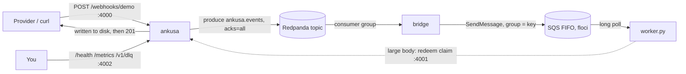

# Example: Ankusa → Kafka (Redpanda) → SQS FIFO (floci) → a Python worker

The published Ankusa image receives webhooks and produces each one to a Kafka
topic on Redpanda. A Redpanda Connect bridge carries the records into an SQS
FIFO queue in floci, with `MessageGroupId` set from the record key (tenant and
source), so a source's hooks reach the worker in the order Ankusa produced them.
That is not the order they arrived in: dispatch runs attempts concurrently and a
retried hook goes out after later ones. For per-key order, set `ordered: true`
and an `ordering_key` on the sink
([Ordering lanes](../../docs/delivery.md#ordering-lanes)). A small Python
worker polls the queue with `boto3` and decodes each message with the `ankusa`
Python SDK ([`packages/sdk-python`](../../packages/sdk-python)). No object
store, and the worker holds no storage credentials.



## What's here

| File | What it is |
| --- | --- |
| `docker-compose.yml` | Redpanda and its topic bootstrap, floci and the queue bootstrap, the bridge, Ankusa on 4000 (ingest) and 127.0.0.1:4002 (admin), and the worker; the claim-check gateway (4001) stays on the compose network |
| `ankusa.yml` | One open `demo` source whose Kafka sink produces to `ankusa.events`, with `inline_max_bytes: 8192` so a ~20 KB hook takes the claim-check path, and retries shortened so the drills are quick |
| `bridge/bridge.yaml` | Redpanda Connect: topic → FIFO queue, `MessageGroupId` from the Kafka key, the deduplication id from the `ankusa_id` header, the offset committed only after SQS accepts the message |
| `pyproject.toml` / `uv.lock` | The worker's `uv` project; `ankusa` resolves to [`../../packages/sdk-python`](../../packages/sdk-python) as a local path dependency |
| `Dockerfile` | Builds the worker with `uv sync --locked`; built from the **repo root** so it can see `packages/sdk-python` (see the comment at its top) |
| `worker.py` | Polls the queue, decodes each message with `ankusa.decode_message`, dedupes on `ankusa.idempotency_key`, redeems claims with `ankusa.ClaimCheckClient`, deletes on success, backs off a transient failure, dead-letters a permanent one |

## Run it

```sh
docker compose up --build -d --wait

# Small: the body rides inline in the message.
curl -XPOST localhost:4000/webhooks/demo -H 'content-type: application/json' -d '{"id":"evt_1","type":"invoice.paid"}'

# Large: the message carries a claim ref; the worker redeems it from the gateway.
printf '{"id":"evt_2","pad":"%s"}' "$(head -c 20000 /dev/zero | tr '\0' x)" |
  curl -XPOST localhost:4000/webhooks/demo -H 'content-type: application/json' --data-binary @-

sleep 2 && docker compose logs worker
# received id=01a0... source=demo via=inline bytes=36 body={"id":"evt_1","type":"invoice.paid"}
# received id=01a0... source=demo via=claim bytes=20023 body={"id":"evt_2","pad":"xxxx...
```

Tear down (the `-v` drops the data volumes too):

```sh
docker compose down -v
```

Editing `worker.py` needs a rebuild (`docker compose up --build -d --wait`):
it's baked into the image, not bind-mounted.

Developing the worker outside Docker: `uv sync && uv run python worker.py`
from this directory, with `SQS_QUEUE_URL`, `SQS_DLQ_URL`, `SQS_ENDPOINT`,
the AWS region and credentials, and `CLAIM_CHECK_URL` set as in
`docker-compose.yml`, against hosts your machine can reach.

## How the worker behaves

- **The consumer side owns the topology.** The topic, the two queues, and the
  bridge are declared in `docker-compose.yml`; Ankusa only produces to
  `ankusa.events`. With no topic, a produce fails, is retried, then
  dead-lettered.
- **Ankusa answers `201` only after the hook is on disk**, and its sink counts
  a hook as delivered only after every in-sync replica has the record.
- **Dedupe on the idempotency key**: delivery is at-least-once. The worker
  records a key only after the hook is handled, so a failure is redelivered,
  not skipped as a duplicate.
- **Only what a retry can fix is retried.** An unreachable claim-check gateway
  backs the message off (its visibility timeout doubles per receive), along
  with the rest of its FIFO group in that batch. Bad JSON, an unknown claim, or
  a sha256 mismatch would fail the same way every time, so the worker moves the
  message to `ankusa-worker-dlq.fifo` and the group keeps moving. The queue's
  own redrive policy moves a message there after 5 failed receives either way.
- Every message is the same JSON the RabbitMQ and NATS sinks publish, so this
  worker's decoding works for those transports too. Format and claim-check
  details: [`../../docs/claim-check.md`](../../docs/claim-check.md).

The drills (worker down, broker down, dead letters, replay) are in
[`docs/quickstart.md`](../../docs/quickstart.md).
