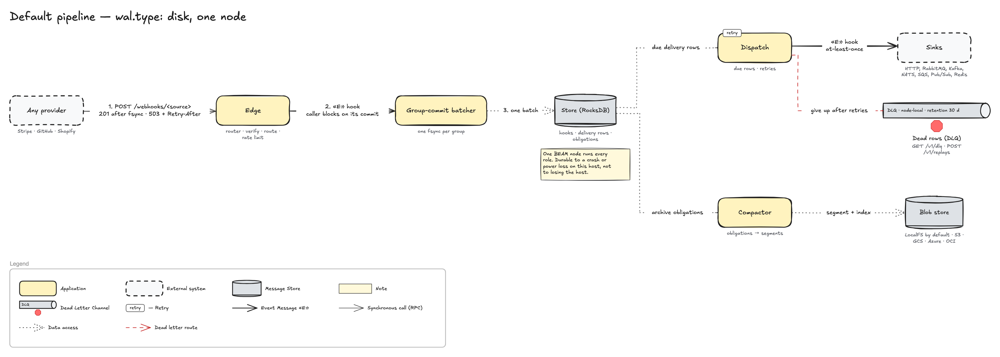

# ankusa

A loosely coupled, high-throughput webhook ingestion framework: durable local RocksDB store,
pluggable verification/storage/delivery, multi-tenant catch-URL routing.



## Installation

```elixir
def deps do
  [
    {:ankusa, "~> 0.7"}
  ]
end
```

See [`https://hexdocs.pm/ankusa`](https://hexdocs.pm/ankusa) for the full
documentation and [`https://github.com/jamescarr/ankusa`](https://github.com/jamescarr/ankusa)
for the source.
